# Appium 自動化測試環境建置

---

> 本文整理建立 Android 自動化測試環境所需的工具，並說明各項工具的安裝與基本設定。
> 

## Appium 運作架構

<aside>
💡

Appium 是一套行動應用程式自動化工具。測試腳本透過 Appium Client 向 Appium Server 發送 WebDriver 請求，再由 Server 呼叫 Android 的 UI Automator 等自動化框架操作裝置。

Appium Server 預設監聽連接埠 `4723`，負責接收並處理 Client 的請求。

</aside>

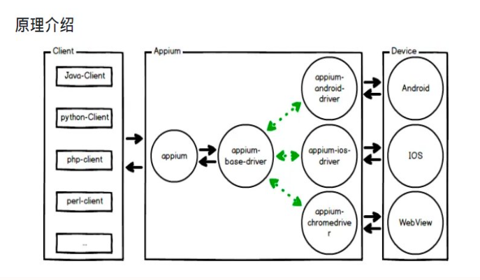

## 安裝前準備

---

- **Python**：撰寫自動化測試腳本。
- **JDK**：提供 Appium 和 Android 模擬器所需的 Java 執行環境。
- **Node.js**：執行 Appium，並透過 npm 管理相關套件。
- **Android SDK**：提供 Android 開發與測試工具，也可用來建立模擬器。
- **Appium Server**：接收測試腳本的請求，並與 Android 裝置互動。
- **Appium Inspector**：以圖形介面檢視應用程式的 UI 元素與屬性。
- **Appium-Python-Client**：讓 Python 測試腳本可以連接 Appium Server。

## 安裝步驟

---

### VS Code 編輯器

> 選擇一套文字編輯器或 IDE，用來撰寫和管理測試腳本。
> 

#### 1. 下載 [VS Code](https://code.visualstudio.com/download)

依照下載頁面的指示完成安裝。

安裝完成後，開啟 Extensions，搜尋並安裝 Python 擴充功能。

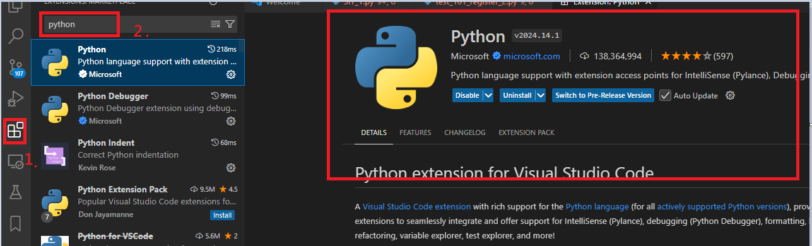

#### 2. 建立第一個 Python 檔案

在 **File → New Text File** 建立新檔案。

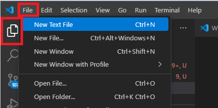

按 `Ctrl+S` 儲存檔案，並將副檔名設為 `.py`。

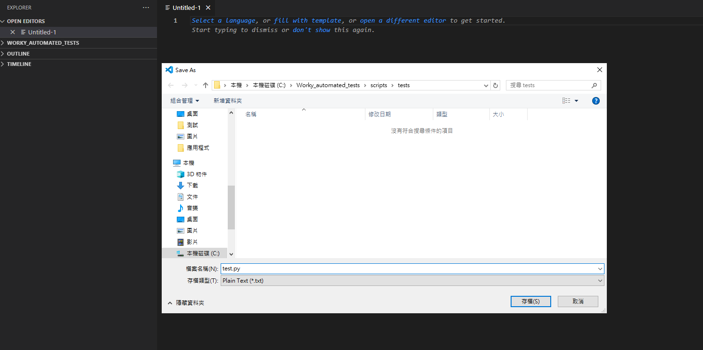

在檔案中加入以下程式碼，匯入 Appium 的 WebDriver：

`from appium import webdriver`

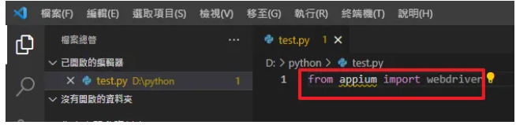

如果此時編輯器顯示找不到 `appium` 模組，請先完成後續的 Python 與 Appium 套件安裝。

### Java 開發工具（JDK）

> Appium 和 Android 模擬器需要 Java 執行環境，因此請先安裝 JDK。
> 

#### 1. 下載 [Java SDK](https://www.oracle.com/java/technologies/downloads/)

建議選擇 JDK 17 或 JDK 21 等 LTS 版本。

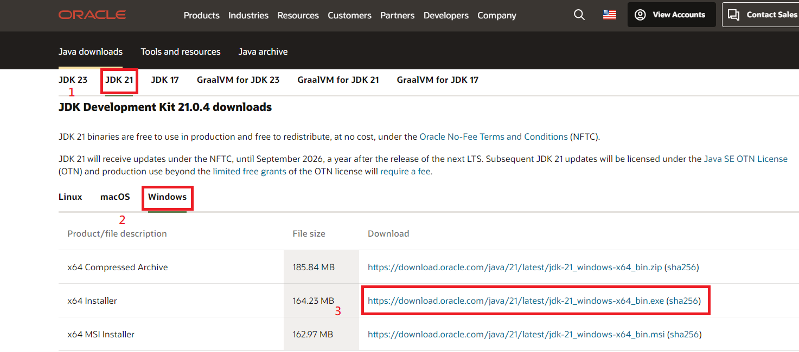

開啟安裝程式，依照畫面指示完成安裝。若沒有特殊需求，可使用預設安裝路徑。


安裝路徑通常位於 `C:\Program Files`。若電腦中安裝了多個 JDK，請先確認要使用的版本與路徑。

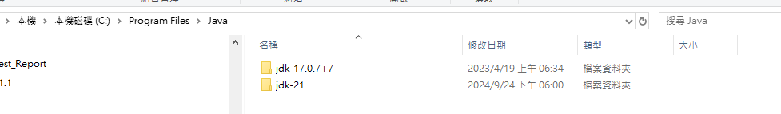

#### 2. 設定環境變數

按 `Windows+R` 開啟「執行」，輸入 `sysdm.cpl`，再按 Enter。

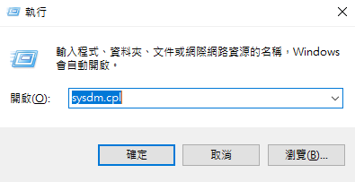

在「進階」頁面中選擇「環境變數」。

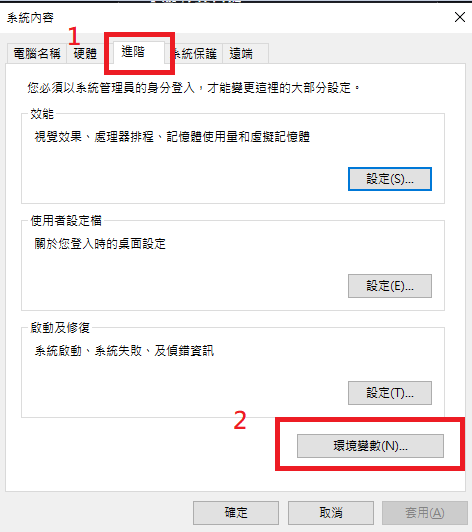

在「系統變數」區域新增變數：

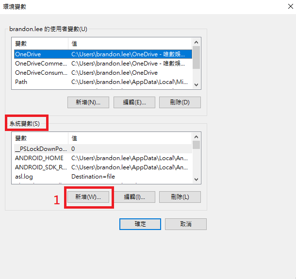

變數名稱設為 `JAVA_HOME`。

變數值設為 JDK 的安裝路徑，例如 `C:\Program Files\Java\jdk-17`。

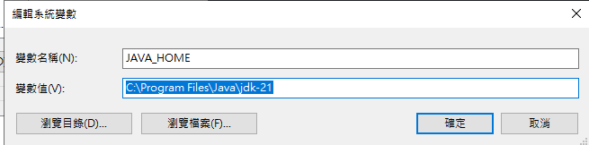

接著編輯 `Path` 變數，加入 JDK 的 `bin` 目錄。

例如，若 JDK 安裝於 `C:\Program Files\Java\jdk-17`，請加入 `C:\Program Files\Java\jdk-17\bin`。

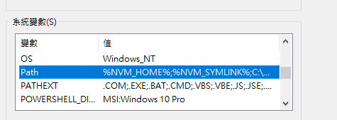

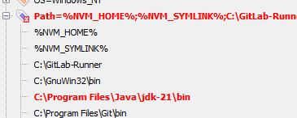

完成後按「確定」儲存設定。重新開啟終端機，讓新的環境變數生效。

### Node.js 執行環境

> Appium 需要 Node.js 執行環境；npm 會隨 Node.js 一起安裝。
> 

#### 1. 安裝 [Node.js](https://nodejs.org/en/)

建議安裝 Node.js 的 LTS 版本。圖中使用的是 `v20.17.0`。

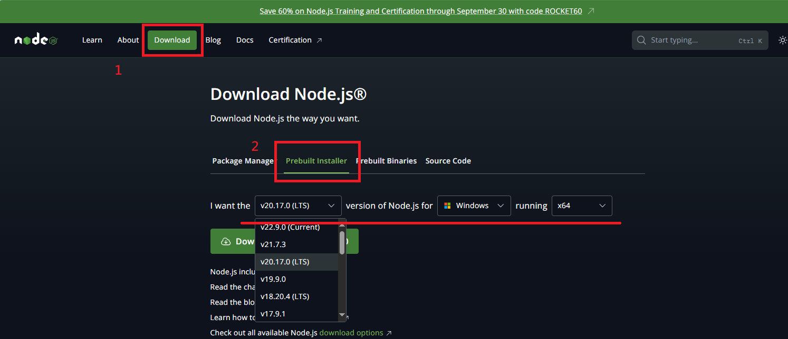

安裝時可保留預設路徑，並依照畫面提示安裝必要工具。

其中的 Chocolatey 是 Windows 套件管理工具，可協助安裝 Python 等開發工具。

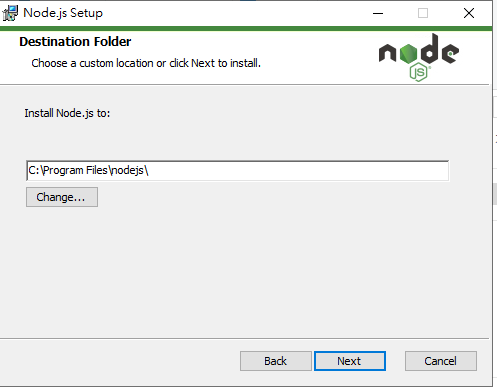

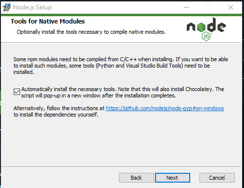

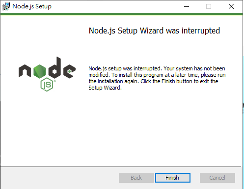

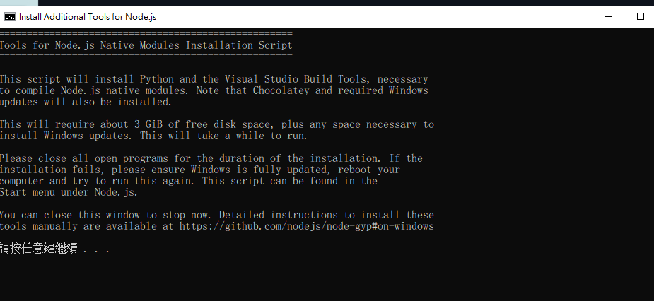

#### 2. 設定環境變數

安裝程式通常會將 Node.js 和 npm 加入系統的 `Path`。

開啟命令提示字元（按 Windows 鍵並輸入 `cmd`）。

執行 `echo %PATH:;=&echo.%`，確認輸出包含 Node.js 和 npm 的路徑。

Node.js 安裝程式會一併安裝 npm，供後續管理 Appium 套件。

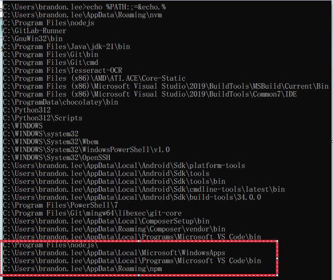

#### 3. 確認安裝結果

在命令提示字元中分別執行 `node -v` 和 `npm -v`。若都能顯示版本號，代表 Node.js 和 npm 已可使用。

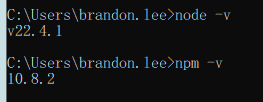

如果命令提示字元顯示找不到 `node`，請先確認 `Path` 中已包含 Node.js 安裝路徑。若安裝檔案不完整，請重新執行安裝程式。

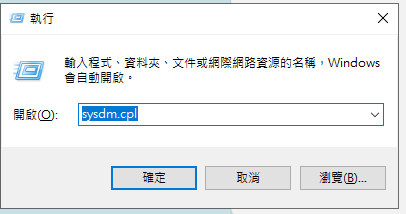

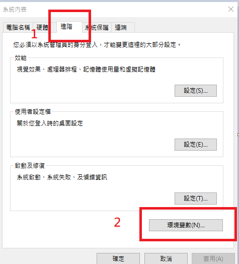

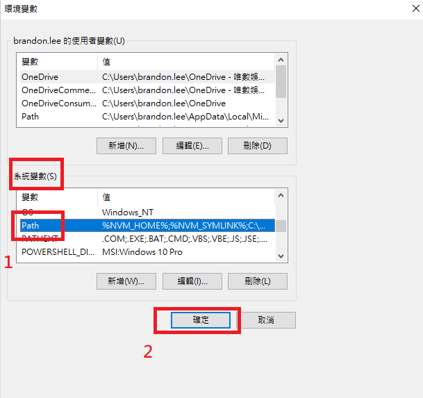

### Android SDK 工具

> Android SDK 提供開發與測試 Android 應用所需的工具，也包含管理模擬器的功能。
> 

#### 1. 安裝 [Android Studio](https://developer.android.com/studio?hl=zh-tw)

若只使用命令列工具，或希望維持較精簡的環境，可以不安裝 Android Studio，改為單獨安裝 Android SDK 工具。

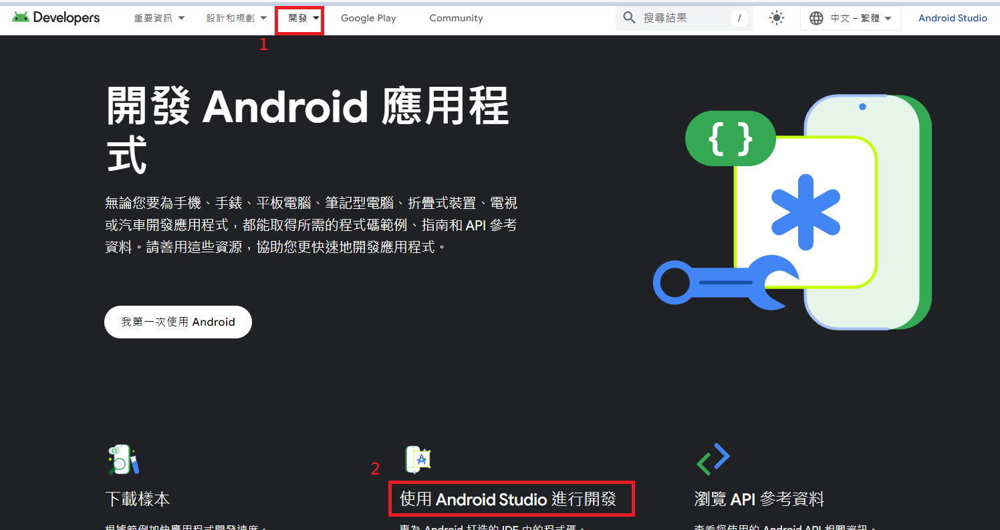

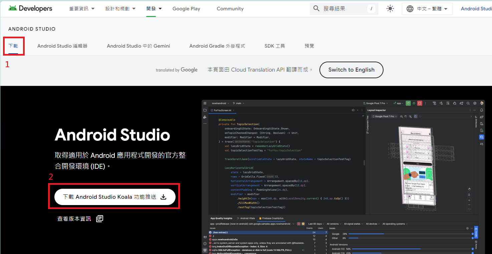

安裝程式會顯示預設安裝路徑。若系統槽空間有限，可將 Android Studio 安裝到其他磁碟，例如 `D:`。

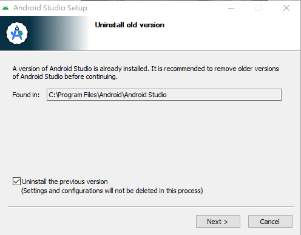

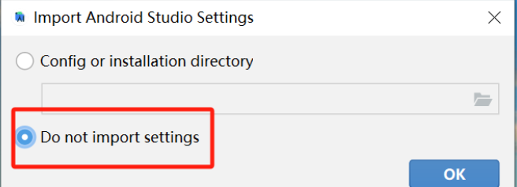

安裝時請選擇 Android SDK 和 SDK Manager，並確認相關工具一併安裝。

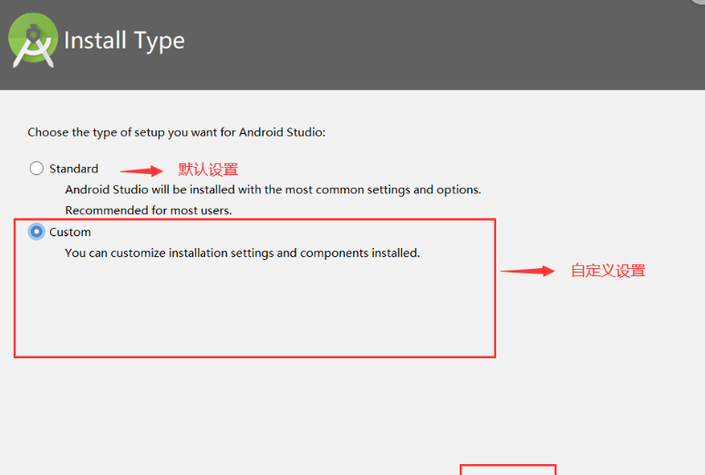

如果需要使用 Android 模擬器，請一併安裝 Android Virtual Device（AVD）相關元件。

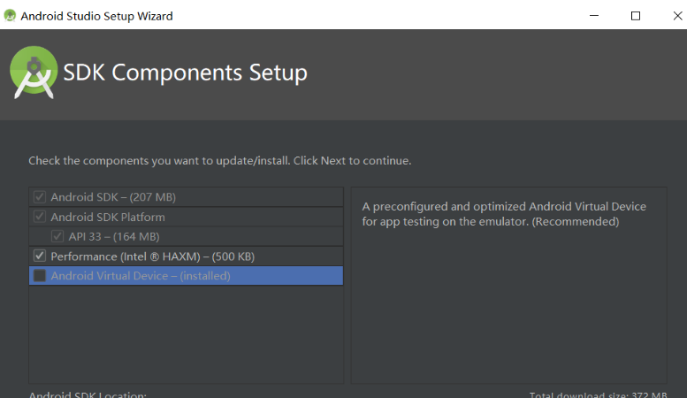

#### 2. 安裝 SDK 工具

安裝完成後開啟 Android Studio。若尚未建立專案，可先新增空白專案，再開啟 SDK Manager。

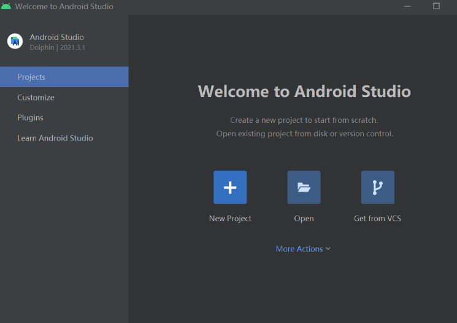

SDK Manager 通常可從工具列或設定選單開啟；不同版本的 Android Studio，選單位置可能略有不同。

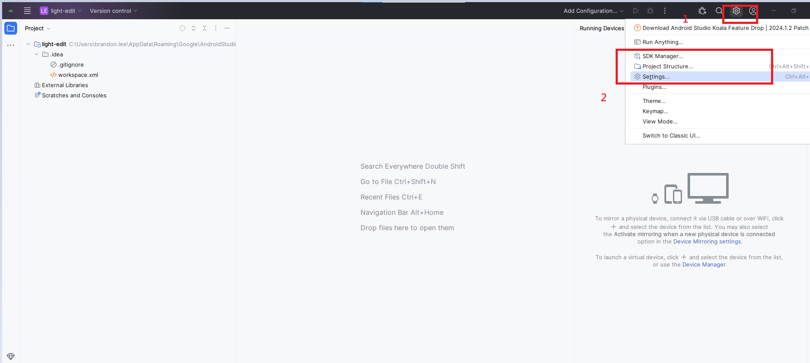

在 SDK Platforms 頁面選取測試所需的 Android 版本。

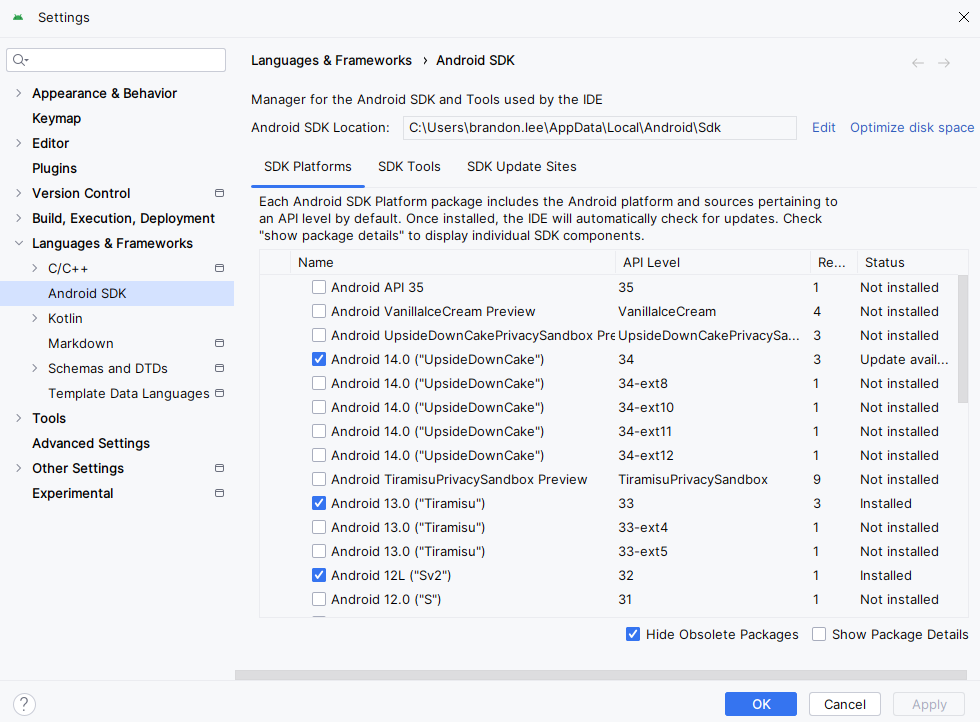

配置 SDK Tool

* Android SDK Build-Tools：編譯 Android 應用所需的工具。

* Android SDK Platform-Tools：包含 `adb` 和 `fastboot`，用於測試及管理 Android 裝置。

* Android Emulator：需要使用模擬器時安裝。

* Android SDK Tools：包含 SDK 管理、除錯與開發所需的工具。

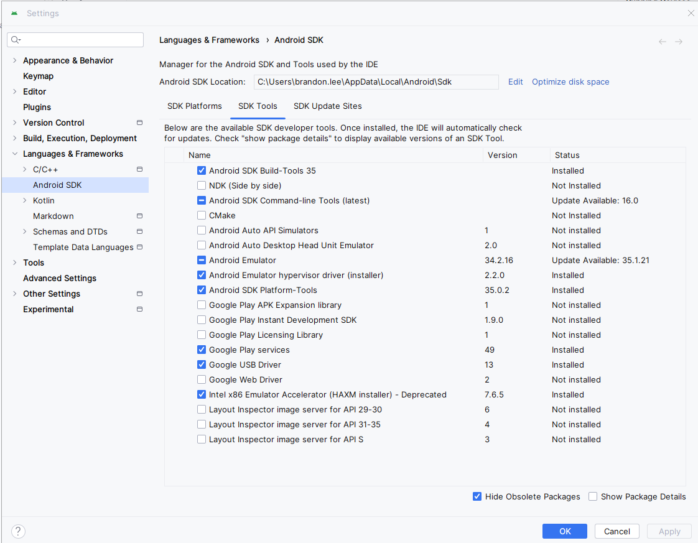

#### 3. 設定環境變數

將 Android SDK 的安裝目錄加入系統環境變數。

新增名為 `ANDROID_HOME` 的變數，值設為 SDK 路徑；實際路徑可在 SDK Manager 中查看。

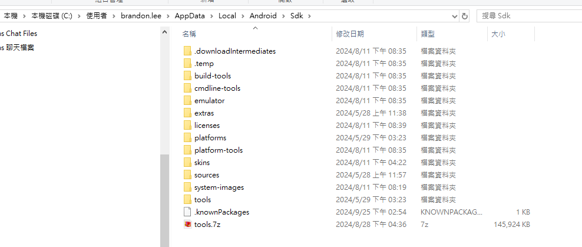


將 SDK 的 `platform-tools` 等工具目錄加入 `Path`，讓命令提示字元可以直接執行相關指令。


#### 4. 確認安裝結果

開啟命令提示字元並執行 `adb devices`。

若指令能正常回應，表示 `adb` 已安裝並可從 `Path` 執行。


如果用傳輸線接上 Android 實體機 並打開發者模式的ADB除錯則會回傳
連線的 device name

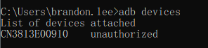

#### 5. 檢查 Appium 執行環境

使用 npm 安裝 `appium-doctor`，再執行該工具檢查 Appium 環境設定。

`npm install -g appium-doctor`

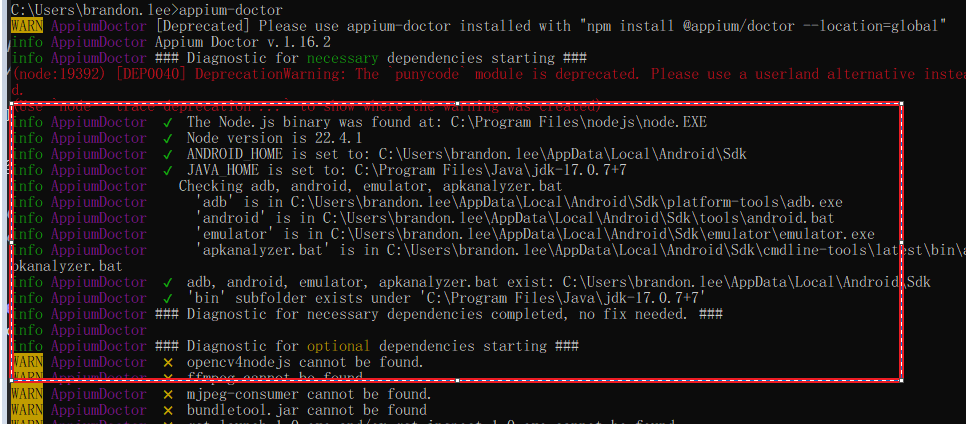

第一段necessary(必要的)不能有X

### Appium Server 伺服器

> Appium Server 可透過 npm 安裝；若需要圖形介面，也可安裝 Appium Server GUI。
> 

#### 1. 安裝 [Appium Server GUI](https://github.com/appium/appium-desktop/releases/tag/v1.6.3)

若不需要圖形介面，可略過 GUI 安裝，直接使用 npm 安裝 Appium。

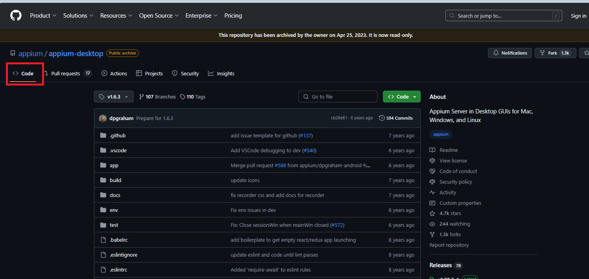

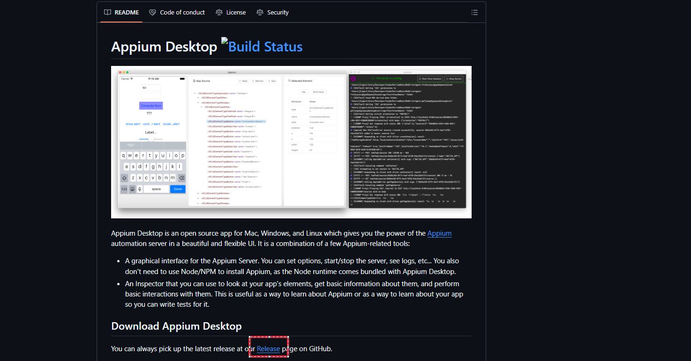

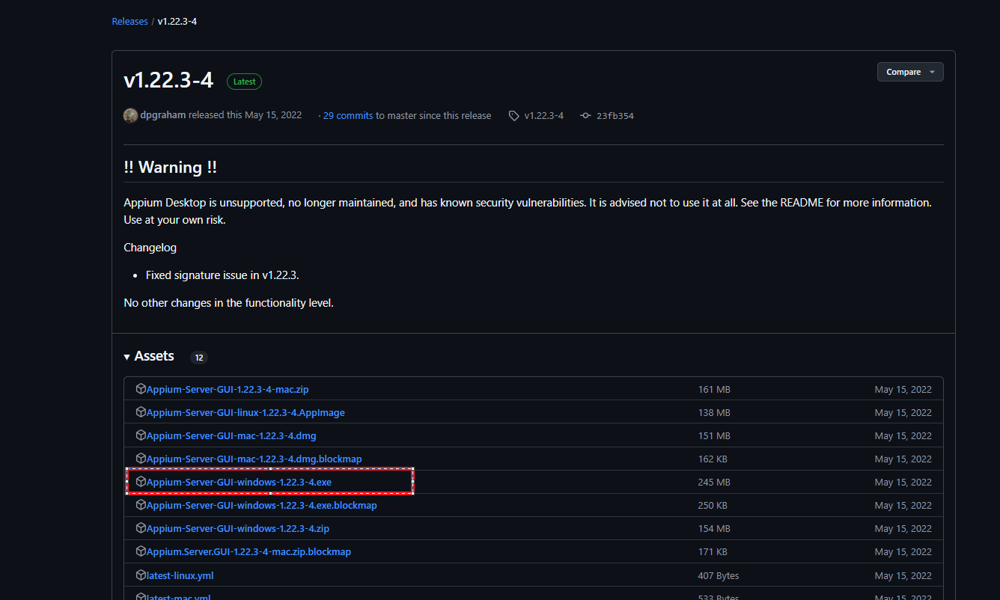

在命令提示字元中執行以下指令，以 npm 全域安裝 Appium：

`npm install -g appium`

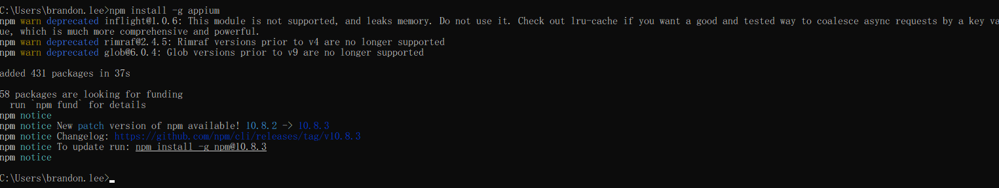

#### 2. 確認安裝結果

執行 `appium -v` 查看版本。若能顯示版本號，代表 Appium 已安裝完成。

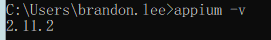

#### 3-1. 設定伺服器參數

開啟 Appium Server GUI，並進入 **Advanced** 設定頁面。

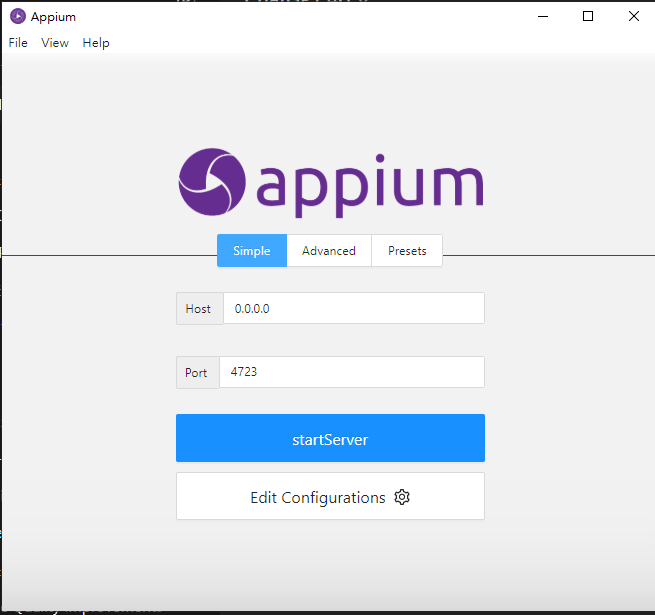

在此頁面可設定伺服器位址、連接埠、Log Level 和 CORS 等選項。

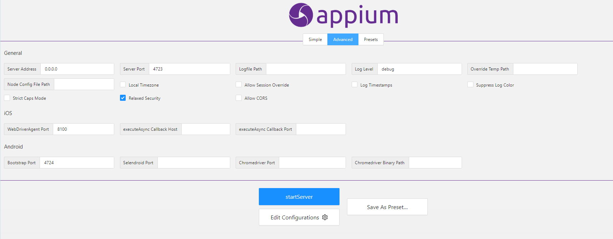

* - [ ] Server Address：

預設值為 `0.0.0.0`。若只在本機執行測試，可維持預設設定。

* - [ ] Server Port：

預設連接埠為 `4723`。若沒有連接埠衝突，可維持預設值。

* - [ ] Log Level：

`debug` 會輸出較詳細的資訊。若不需要完整 Log，可依需求改為 `info`、`warn` 或 `error`。

* - [X] Override Temp Path：

此選項會覆寫 WebDriver Endpoint。只有 Client 端設定需要 `/wd/hub` 時才啟用，並確認 Client 與 Server 使用相同的 Endpoint。

* - [X] Relaxed Security：

此選項會放寬 Appium 的安全限制。只有測試確實需要額外指令（例如檔案上傳）時才啟用。

* - [X] Allow CORS：

只有在瀏覽器需要從不同來源存取 Appium Server 時，才需要啟用 CORS。

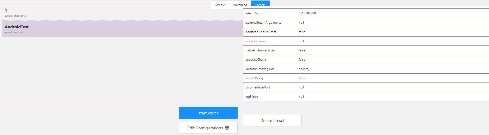

設定完成後，選擇 **Save As Preset**，即可從 Presets 選單重複使用這組設定。

#### 3-2. 啟動 Appium Server

也可以在命令提示字元執行 `appium` 啟動 Server。預設情況下，Server 會監聽本機的 `127.0.0.1:4723`。

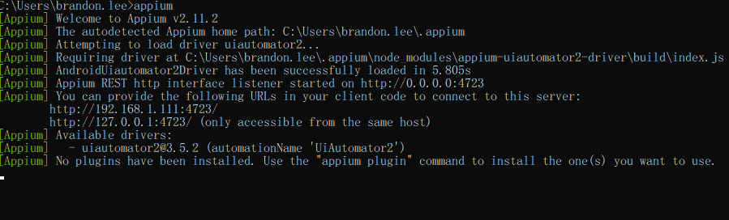

### Appium Inspector 元素檢視器

> Appium Inspector 用於檢視應用程式的 UI 元素。Appium Desktop 1.22 起，Server 與 Inspector 已分為不同工具。
> 

#### 1. 安裝 [Appium Inspector](https://github.com/appium/appium-inspector/releases)

在 Windows 上下載最新版本的 `.exe` 安裝檔，並依照畫面指示完成安裝。

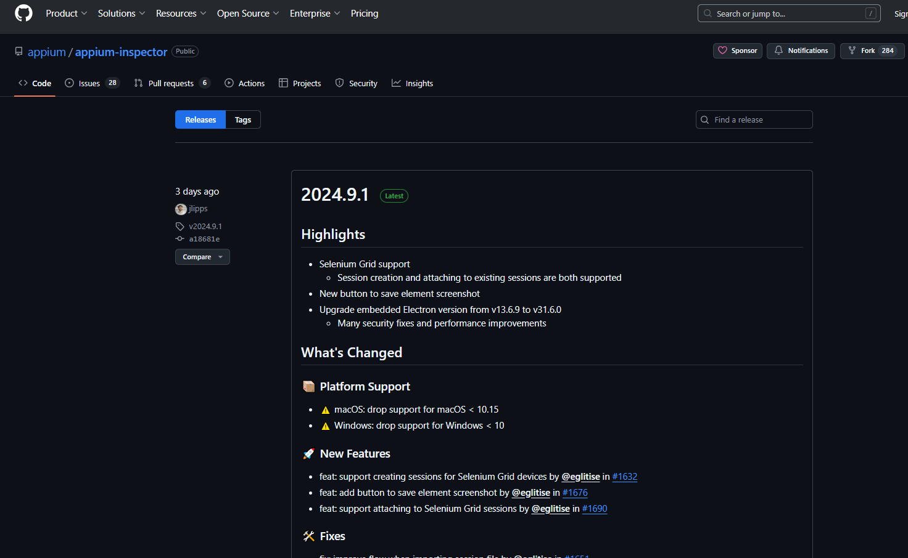

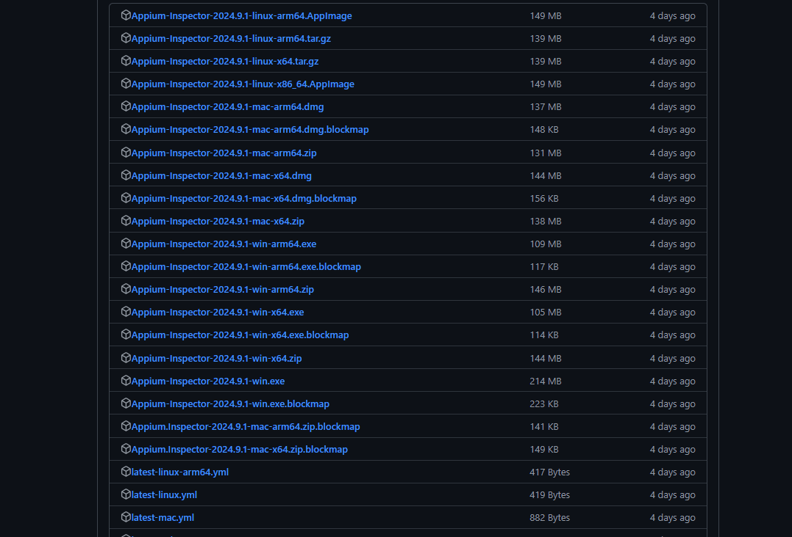

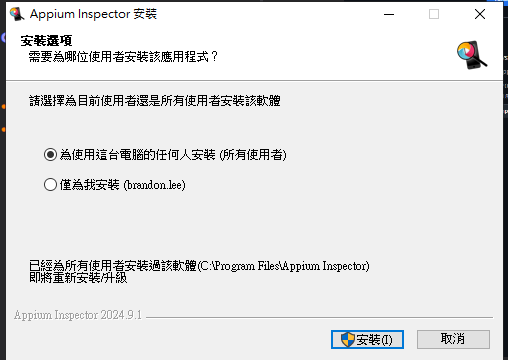

#### 2. 設定 Appium Inspector

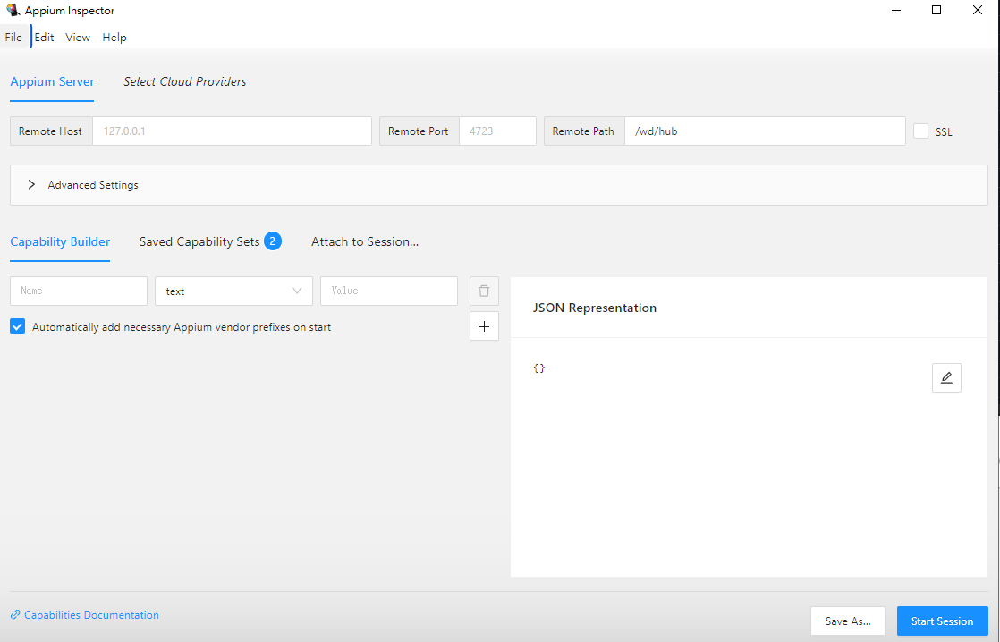

依照圖片設定所需的 Capabilities，並儲存為 Preset，方便後續重複使用。

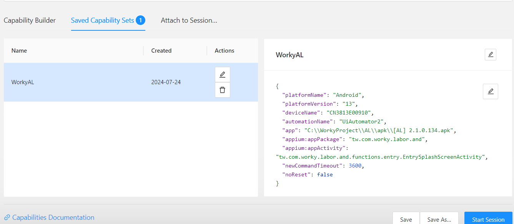

前四項用來指定測試平台與裝置：

```
* platformName
* deviceName
* platformVersion
* automationName (選填)
```

中間三項用來指定 APK 路徑和應用程式資訊。可以從 APK 檔案或使用 ADB 指令查詢相關值。

在 Appium 2 中，`appPackage` 和 `appActivity` 使用 Android 專屬 Capability 名稱，因此需加上 `appium:` 前綴：

```
* app
* appPackage
* appActivity
```

以下兩項是 Session Capabilities，用來設定 Appium 啟動應用程式和維持 Session 的行為，例如逾時時間或是否重設應用程式：

```
* newCommandTimeout
* noReset
```

### Appium Python Client

> Python 測試腳本需要透過 Client 與 Appium Server 通訊。本文使用 `Appium-Python-Client`，並以 pip 安裝。
> 

#### 1. 下載 [Python](https://www.python.org/downloads/)


安裝時確認已選取 pip。Python 安裝程式通常也會一併安裝 pip。


若沒有特殊需求，可使用預設安裝路徑。若自行更改路徑，請確認 Python 和 pip 已加入 `Path`。


此範例將 Python 安裝在 `C:`。


若 pip 安裝在其他位置，請將對應的 Python 與 Scripts 目錄加入 `Path`。

#### 2. 在 VS Code 選擇 Python Interpreter

回到 VS Code，按 `Ctrl+Shift+P` 開啟命令面板，輸入 `Python: Select Interpreter`，再選擇剛安裝的 Python。


這項設定會決定 VS Code 執行腳本時使用的 Python 版本。若使用虛擬環境，也請在此選取對應的 Interpreter。

#### 3. 安裝 Appium-Python-Client

在命令提示字元執行 `pip -V`，確認 pip 可正常使用。


接著執行 `pip install Appium-Python-Client` 安裝 Client 套件。此範例安裝的是 Appium-Python-Client 2.11.0 和 Selenium 4.23.1。


#### 4. 確認 VS Code 沒有錯誤

回到 VS Code，按 `Ctrl+Shift+P` 開啟命令面板，輸入 `Reload Window` 並重新載入視窗。


重新載入後，確認匯入 Appium 的程式碼不再顯示錯誤。


