# 自動化測試腳本架構

> 本文說明如何以資料驅動、操作模組化和頁面模組化，整理 UI 自動化測試腳本。

---

1. **資料驅動測試**：將測試資料與元素資訊存放在 XLSX 檔案中，例如測試帳號、電話號碼或「開始」按鈕的元素 ID。
2. **操作模組化**：將常用的 UI 操作和邏輯封裝成函數，例如點擊按鈕或產生測試資料。
3. **頁面模組化**：依照應用程式頁面整理操作，讓主測試流程可以呼叫各頁面的測試模組。


```markdown
### 📁 API 測試腳本目錄

| 資料夾 / 檔案         | 說明 |
|----------------------|------|
| `api/employer/`      | 商家端 API |
| `api/labor/`         | 打工端 API |
| `api/test/`          | API 測試互動邏輯 |
| `tools/`             | 工具類（Socket 傳遞、Header 處理） |
| `env.py`             | API 環境變數 |
| `start_server.py`    | 模擬資料伺服器 |
| `test_data.py`       | 測試資料（如註冊電話） |
```


## 專案範本

---

### 步驟 0：準備專案根目錄

將專案原始碼下載到 Windows 電腦。本範例將專案放在 `C:`，並命名為 `Worky_UITest`。

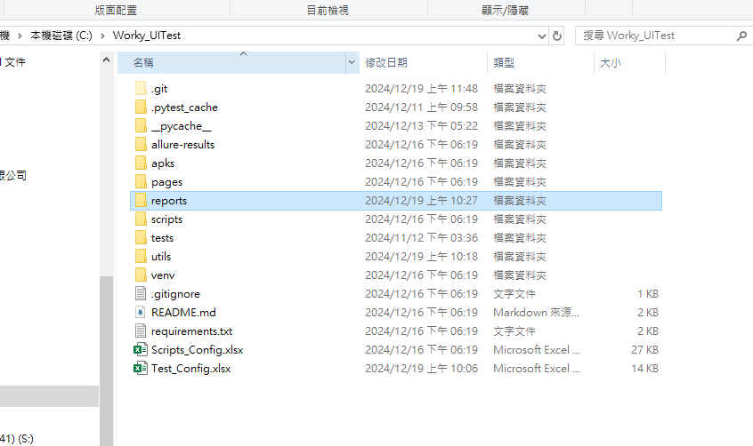

### 步驟 1：使用資料驅動測試

專案根目錄中的 `Scripts.xlsx` 用來記錄測試所需的元素資訊。這些定位資料供腳本查詢使用。

例如，打工端 onboarding 頁面的「下一頁」按鈕記錄在 `Scripts.xlsx` 第 4 列。

`Name` 欄位填入 `l1_下一頁`，對應的 `wait_id` 欄位則填入 `tw.com.worky.labor.and:id/iv_next`。

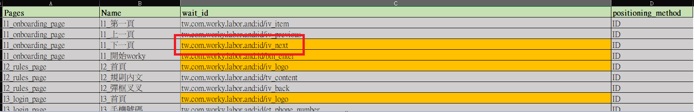

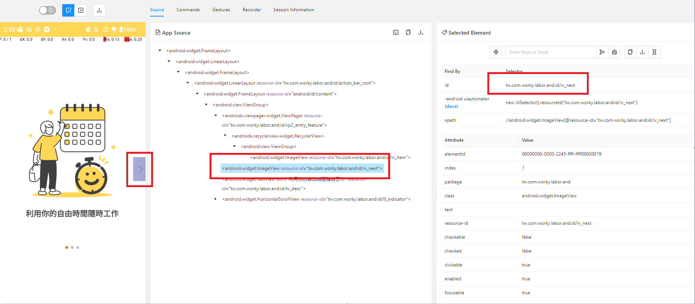

在 onboarding 頁面測試中要點擊這個按鈕時：

1. 將 `Scripts.xlsx` 載入頁面測試腳本。
2. 呼叫既有的點擊方法，並將 `Name` 欄位的值傳入 `click_by_locating` 函數。

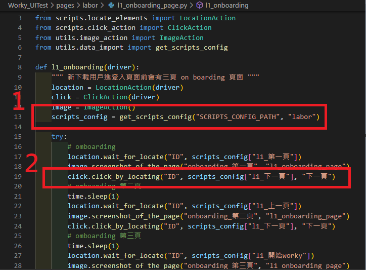


<aside>
💡
常見問題：欄位命名方式

</aside>

> Q1：為什麼要這樣設計 `Name` 欄位？
> 

> A：腳本會依照 `Name` 欄位查找元素，因此每個值都必須唯一。可以在名稱前加上頁面代號，避免不同頁面的元素名稱重複。
> 

> Q2：其他欄位要如何命名？
> 

> A：除 `Name` 和 `wait_id` 外，其餘欄位可依團隊需求命名，主要用來補充說明或方便查詢。也可以使用對應的頁面模組名稱。
> 

> Q3：黃色資料格代表什麼？
> 

> A：黃色資料格是覆寫後的 `wait_id` 值。這份範例依頁面整理元素，讓資料欄位與頁面操作保持對應，方便後續維護和擴充。
> 


`Test_Config.xlsx` 的第一張工作表 `Device&App_Config` 用來保存 Appium Driver 連線所需的 Capabilities。若要新增設定，請先確認 Appium 文件中對應的 Capability 名稱和值。

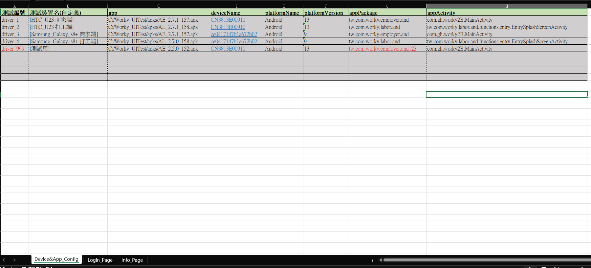

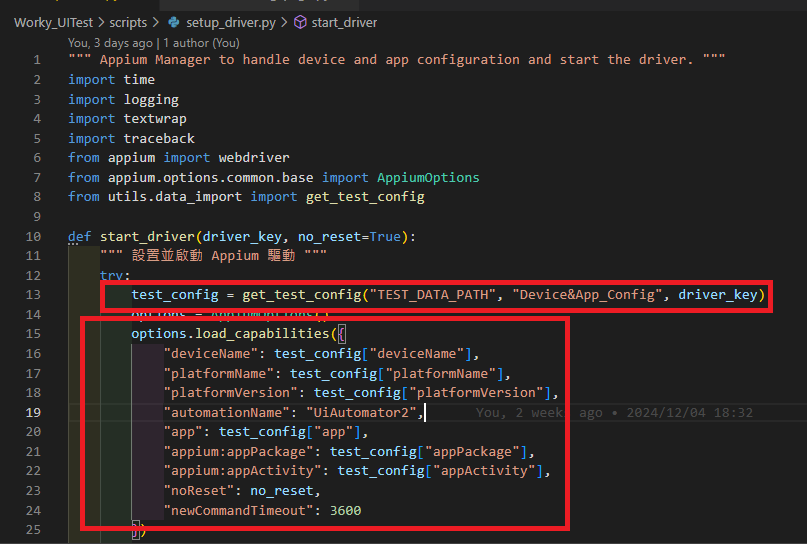

除 `Device&App_Config` 外，其餘工作表用來保存測試資料，載入方式與前述範例相同。

紅字欄位是刻意準備的錯誤資料，可用來確認系統如何處理不合法輸入。

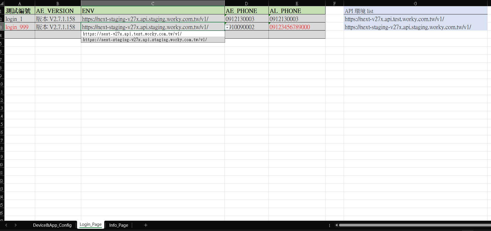

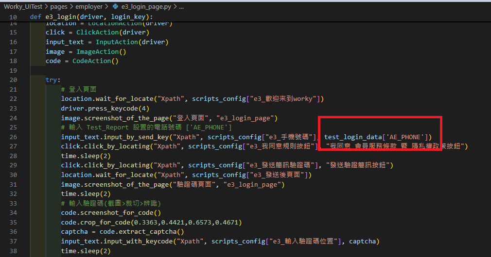

工作表已設為保護狀態，避免不小心修改資料。

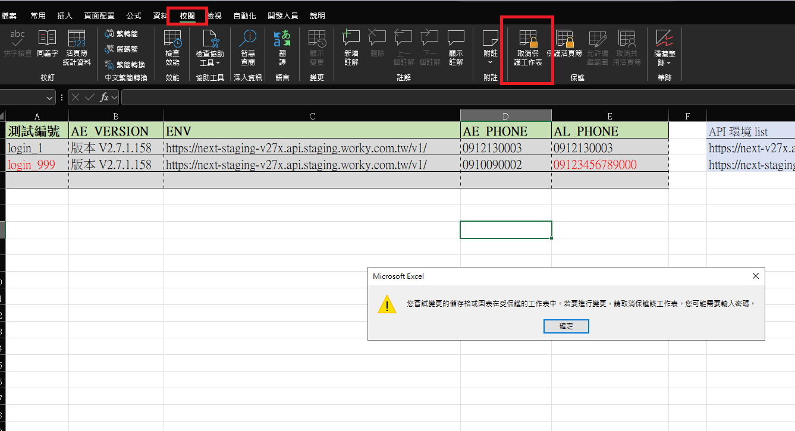

### 步驟 2：將操作拆分為模組

`scripts/` 子資料夾位於專案根目錄，存放與 App 連線及 UI 操作相關的模組。

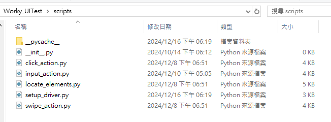

UI 測試的主要操作可分為以下幾類：

1. 連接測試裝置。
2. 定位 UI 元素。
3. 操作已定位的元素，例如點擊、輸入和滑動。

這些操作分別由不同模組負責。以下介紹常用函數及其參數。

#### `setup_driver`

> `setup_driver` 負責設定裝置與 App，並啟動或關閉 Appium Driver。
> 

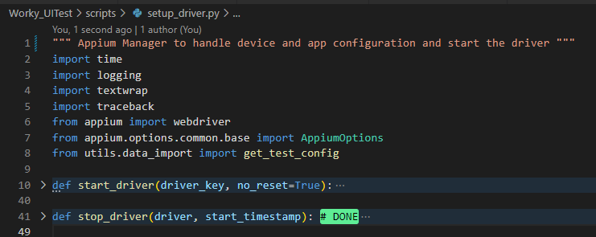

一般情況下，使用時只需要留意 `no_reset` 變數。

#### `location_elements.py`

> 此模組負責等待 UI 元素出現，並依指定條件定位元素。
> 

`positioning_method_dict` 用來管理可使用的定位方法。

`conditions_dict` 用來管理元素狀態的判斷條件。

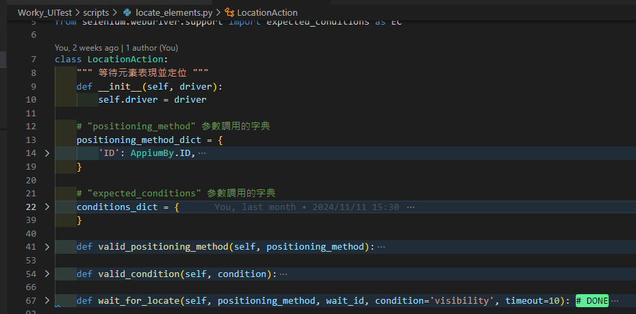

`wait_for_locate` 會依照 XML 中的元素資訊定位目標元素。呼叫時至少需要提供兩個參數：定位方法和元素資訊。

`condition` 預設檢查元素是否可見；`timeout` 預設為 10 秒。

以下是函數範例：

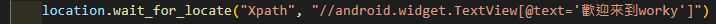

#### `click_action.py`

> 此模組封裝依元素定位或依座標點擊的操作。
> 

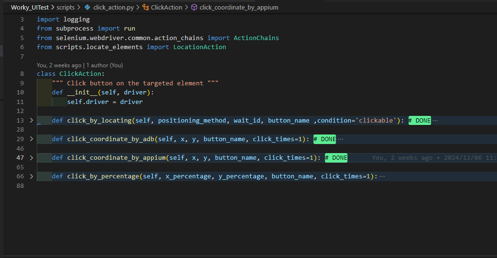

`click_by_locating` 會先定位元素再執行點擊。至少需要提供定位方法、元素資訊和自訂按鈕名稱。

`condition` 預設檢查元素是否可點擊。

以下是函數範例：

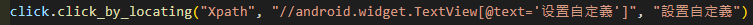

`click_by_percentage` 會依畫面座標的百分比點擊。至少需要提供 X 軸百分比、Y 軸百分比和自訂按鈕名稱。

`click_times` 預設為 `1`。

以下是函數範例：

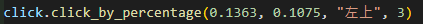

#### `input_action.py`

> 此模組封裝文字和數字的輸入操作。
> 

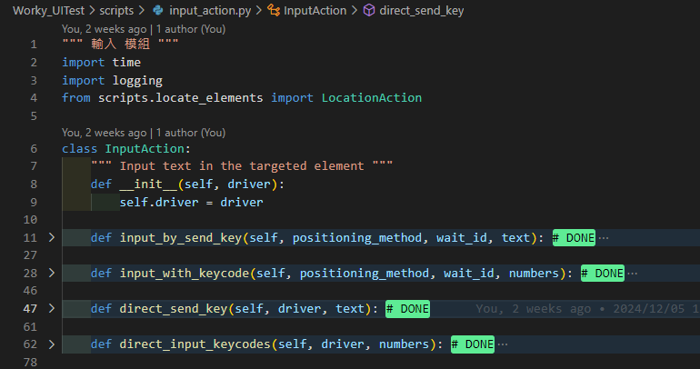

<aside>
⚠️

UI 自動化測試會經過前端驗證，因此測試資料應符合應用程式的輸入規則；若要測試錯誤處理，請使用專門設計的無效資料。

</aside>

`input_by_send_key` 會先定位元素，再使用 `send_key` 輸入內容，通常用於文字欄位。

至少需要提供定位方法、元素資訊和輸入值。以下是函數範例：

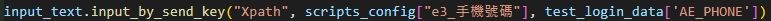

`input_with_keycode` 會先定位元素，再使用 Keycode 輸入內容，通常用於數字欄位。

至少需要提供定位方法、元素資訊和輸入值。以下是函數範例：

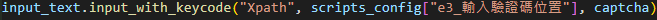

#### `swipe_action.py`

> 此模組提供依照畫面座標百分比執行滑動的操作。
> 

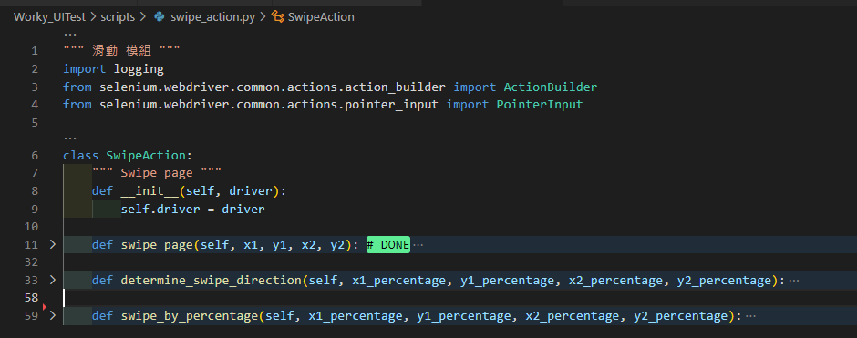

`swipe_by_percentage` 會依畫面座標百分比執行滑動。呼叫時需提供起點和終點的 X、Y 百分比，共四個參數。

以下是函數範例：

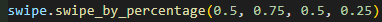

### 步驟 3：依頁面拆分測試模組

`pages/` 子資料夾依商家端和打工端分開存放頁面操作，並將各頁面封裝成模組。

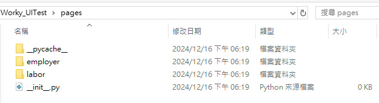

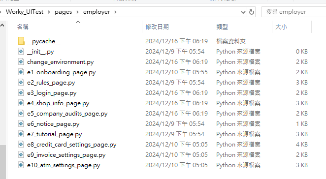

例如，`pages/employer/e3_login_page` 負責商家端登入頁面的操作。

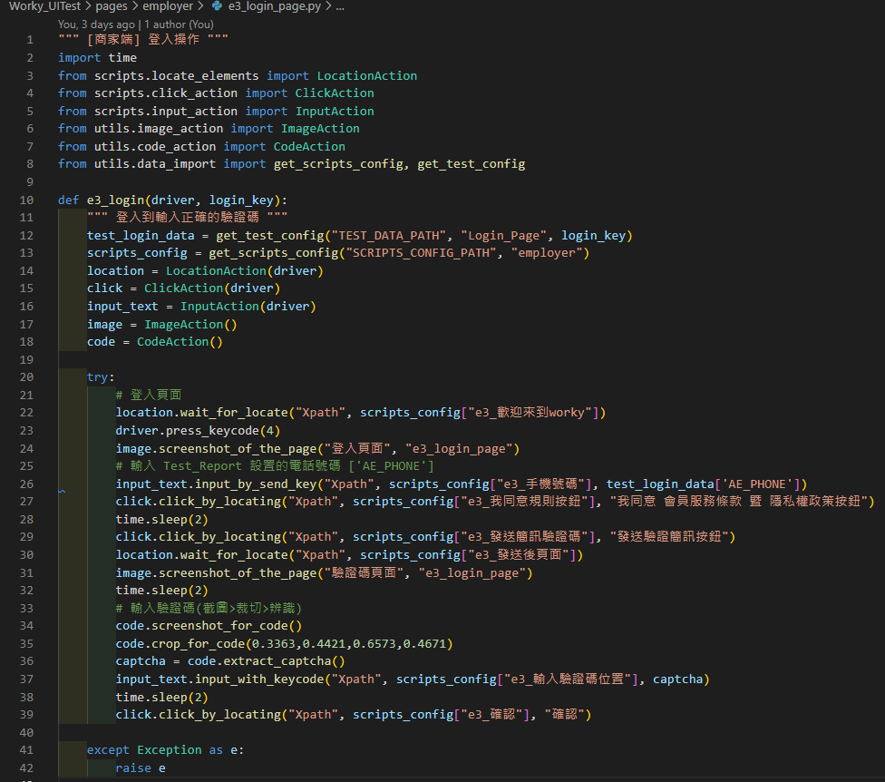

1. 匯入需要的頁面操作模組。
2. 載入資料驅動設定，選擇要使用的測試資料。
3. 撰寫頁面測試流程。

## 建立 Python 虛擬環境

---

在專案根目錄建立 Python 虛擬環境：

1. 建立虛擬環境：`python -m venv venv`
2. 啟動虛擬環境：
    
    **Windows** : `.\venv\Scripts\activate`
    
    **MacOS / Linux** : `source venv/bin/activate`
    
3. 安裝相依套件：`pip install -r requirements.txt`

## 執行測試

---

`tests/` 子資料夾位於專案根目錄，存放主測試腳本。每個腳本會依序呼叫需要測試的頁面模組。

[`1.py`](http://1.py) 是簡短的範例腳本，可用來確認基本測試架構是否正常。

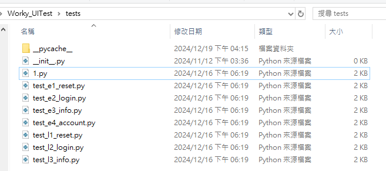

例如，`tests/test_e1_reset` 代表商家端啟動流程測試，主要包含：

1. 清除快取並重新啟動商家端 App。
2. 檢查 onboarding 頁面。
3. 檢查規則功能。

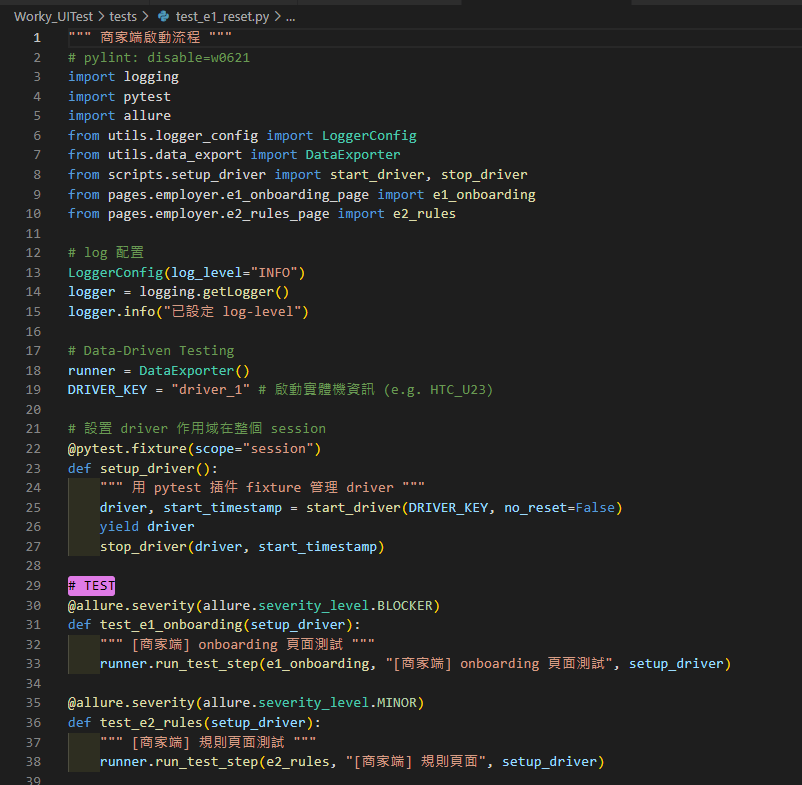

主測試腳本依序處理以下工作：

1. 設定 Log Level。
2. 載入測試資料。
3. 管理 Driver 的啟動與關閉。
4. 執行頁面測試。

可直接使用 Python 執行腳本；下圖以 `1.py` 為例。

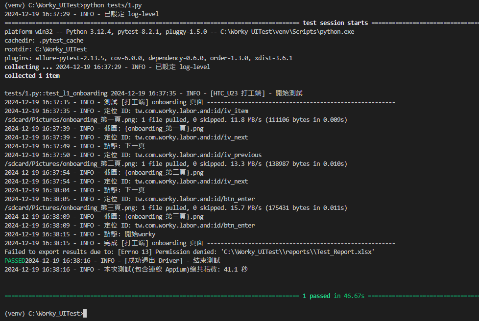

- 可使用 [Vysor](https://www.vysor.io/) 查看裝置畫面。
    
    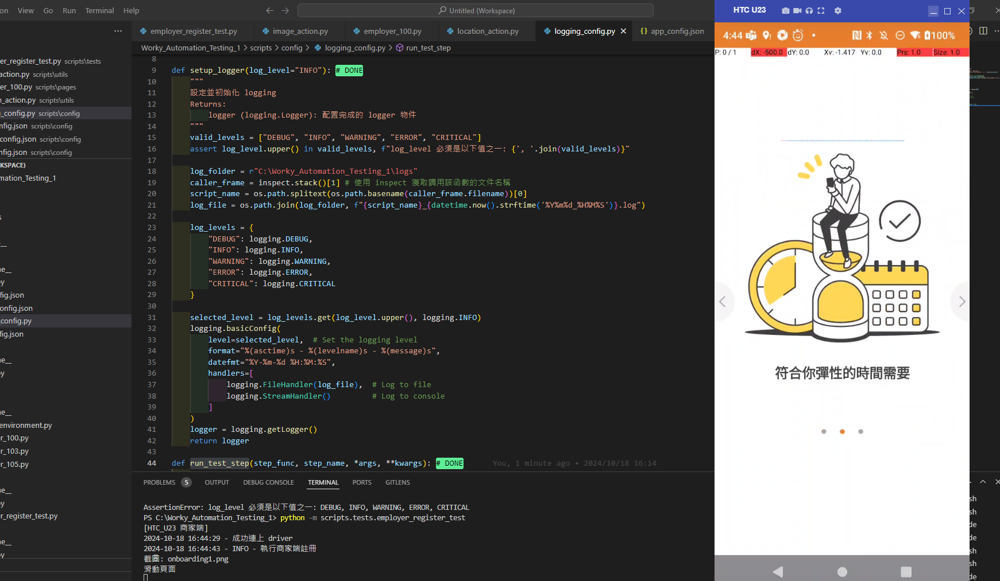
    

## 檢查程式碼風格

---

在 VS Code 安裝 Python 擴充功能和 Pylint，檢查程式碼風格。此專案建議 Pylint 分數達 8 分以上。

執行 `c:/Worky_UITest/utils/pylint_report.py` 產生檢查報告。

在 `TARGET_DIRECTORIES` 中指定要分析的資料夾。

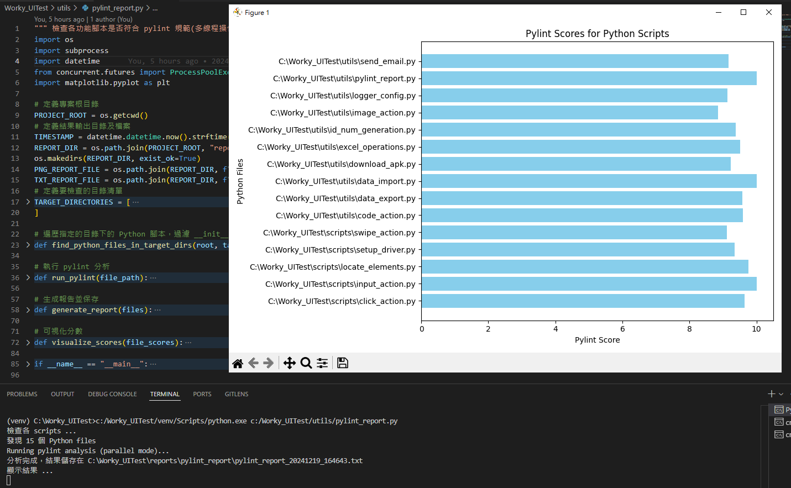

報告會存放在 `reports/pylint_report` 目錄，包含：

1. 長條圖（PNG），顯示各檔案的 Pylint 分數。
2. 詳細報告（TXT），列出未達標項目，例如單行過長或缺少文件說明。

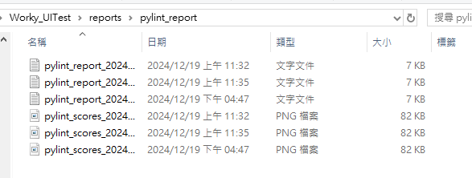

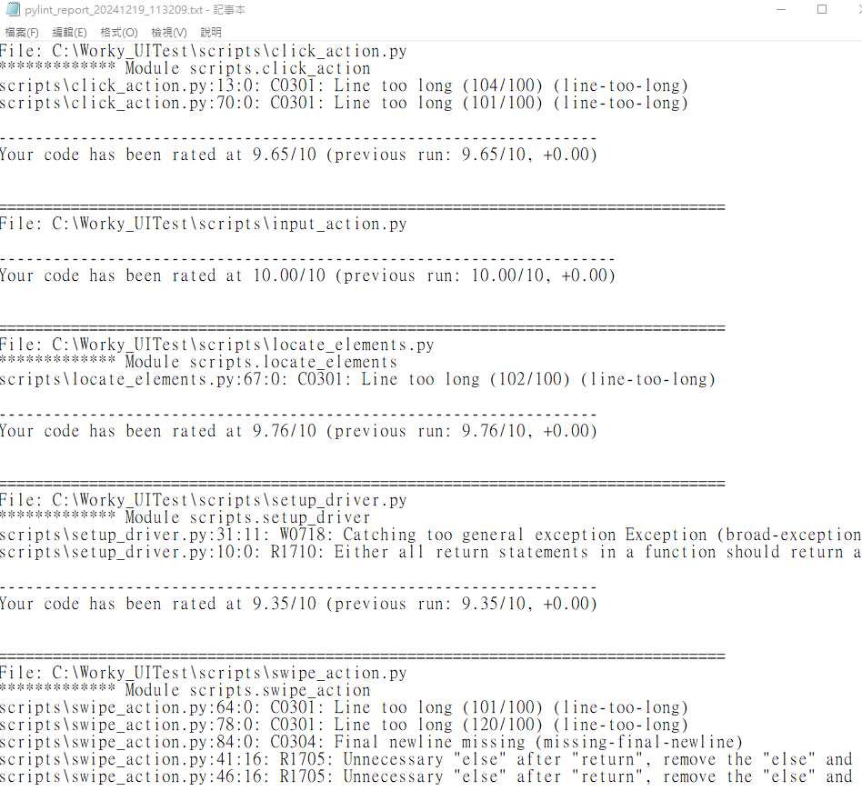
