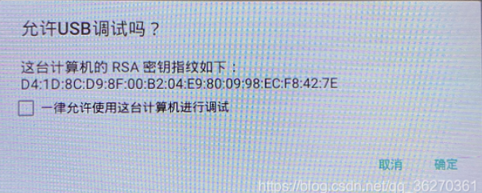
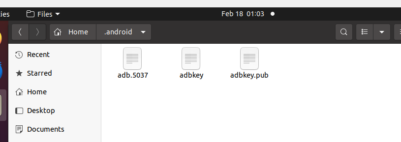
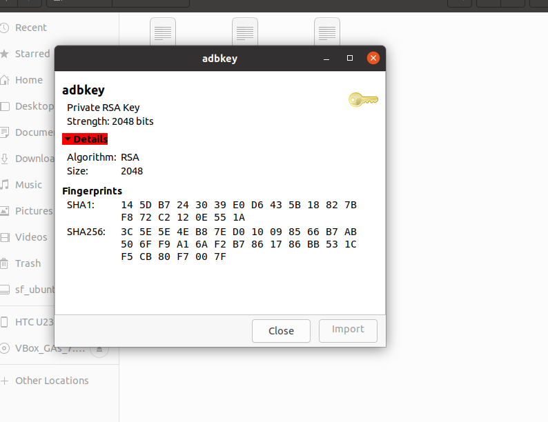
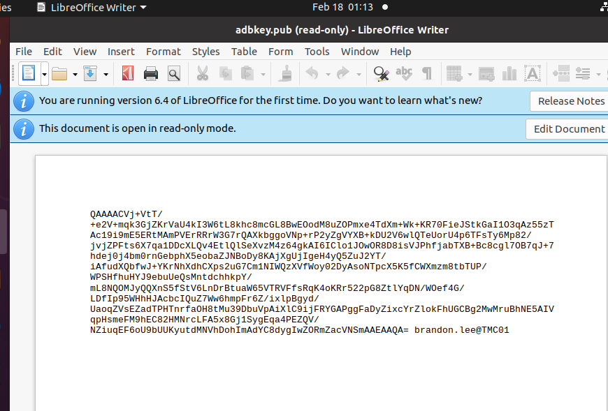
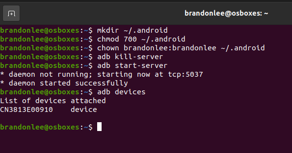
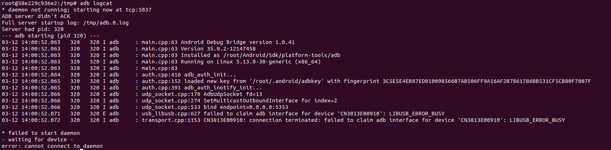
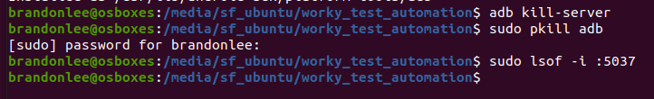
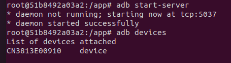

# ADB 疑難排解

> 本文整理 Android 裝置出現 `unauthorized`、`offline`，或無法由 ADB 控制時的排查方式。

---

## USB 偵錯授權視窗沒有出現

如果 Android 裝置沒有顯示「**允許 USB 偵錯？**」對話框（如下圖），可能是 ADB 金鑰（`adbkey`）未正確建立，或 USB 連線與授權狀態異常。



### 可能原因

1. **ADB 金鑰未正確建立**
    
    ADB 連線時會在 `~/.android/` 目錄中建立 `adbkey` 和 `adbkey.pub`。這兩個檔案分別是用於授權的 RSA 私鑰與公鑰。
    
    - 如果檔案遺失、損壞或權限設定錯誤，裝置可能無法完成授權，因而顯示 `unauthorized`。
2. **USB 連線異常**
    - 更換 USB 線，或改用其他 USB 連接埠。
    - 確認 Android 裝置的 USB 模式已設為「僅充電」或「檔案傳輸」。
    - 在開發者選項中關閉再重新開啟 USB 偵錯，接著重新插拔裝置。
3. **舊的 ADB 程序仍在執行**
    - 執行 `adb kill-server` 關閉 ADB Server，再執行 `adb start-server` 重新啟動。
    - 執行 `adb version` 檢查 ADB 版本，確認使用的是預期版本。

### 手動重設 `adbkey`

如果 `adbkey` 未自動建立，可以從已獲得裝置授權的電腦複製 `adbkey` 和 `adbkey.pub`，再放到需要使用的電腦。常見位置如下。在 Ubuntu 上，可執行 `sudo nautilus ~/.android/`，以管理員權限開啟該目錄。

1. `/home/your-username/.android/` 目錄內，或
2. `/root/.android/`



`adbkey.pub` 應包含 RSA 公鑰內容。






## 排除 `adb offline` 狀態

```bash
adb kill-server
adb usb
adb reconnect
adb devices
```

如果重新連線後仍持續授權失敗，電腦上可能有多個 `.android` 目錄，導致 ADB 讀取到不同位置的金鑰。

先確認各個 `.android` 目錄的位置，再移除不需要的目錄並重新建立金鑰。完成後重新啟動 ADB Server，再檢查裝置狀態。




## `adb` 無法存取 USB 裝置

如果容器無法存取 USB 裝置，可能是 Ubuntu 主機上的 ADB Server 已占用該裝置。



1. 在主機上停止 ADB Server，並確認連接埠 `5037` 沒有被其他 ADB 程序占用：

```bash
adb kill-server
sudo pkill adb
sudo lsof -i :5037  # 確認沒有 ADB 程序占用此連接埠
```



2. 在容器內重新啟動 ADB Server，並確認裝置已列出：

```bash
adb start-server
adb devices
```


