# API Testing

---

> 利用 Socket 管理 Response 內的數據調用(e.g. Token)，在本機啟動多個終端
> 

（至少一個 Server 與多個 Client）

1. 獨立運行一個終端作為 Server
2. 執行測試腳本(Client)以發起 API 請求，並與 Server 進行交互

## Project Structure

---

Project/api
├─ employer/            商家端 API
├─ labor/                   打工端 API
├─ test/                     測試多支 API 間交互
├─ tools/                   封裝腳本內部邏輯 (e.g. Socket 傳遞、生成 Header)
├─ *env.py*                  API 環境變數管理
├─ start_server.py     模擬資料存儲的本地 Server
└─ test_data.py         測試數據 (e.g. 註冊電話)

## Run Tests

---

1. 開啟一個終端運行 `python -u "c:\Worky_UITest\api\start_server.py”`

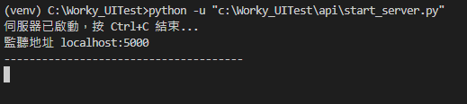

1. 檢查測試數據

測試多支 API 交互(主測試)的測試數據直接封裝在函數內部

各別測試單支 API 時，測試數據可以建檔案(e.g. test_data)管理

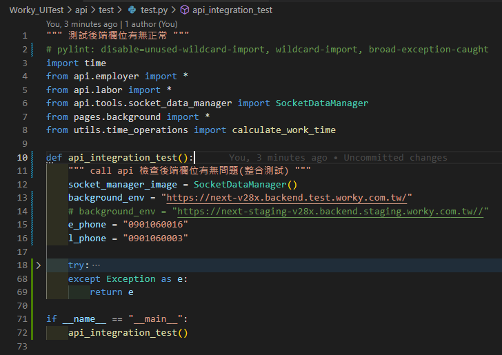

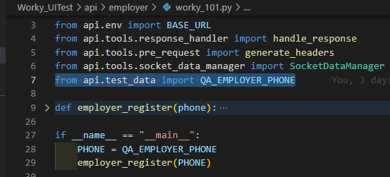

1. 執行結果會打印在終端

可以查看後台 API LOG 來調適

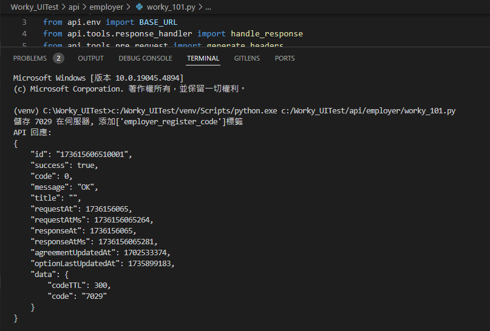

Server 內會顯示儲存跟提取的相關紀錄可以查看

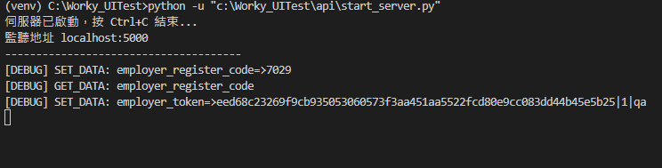

## Socket Design

---

### 1. socket_data_manager

<aside>
💡

1. 管理伺服器端口
2. 管理提取/儲存函數的邏輯
</aside>

伺服器初始化時綁定了指定的 IP（`localhost`）與埠號（`5000`），提供了支持多客戶端並發連線的基礎架構。伺服器通過 `SocketDataManager` 管理共享數據，允許多個 Client 端同時連接並訪問共享資源。

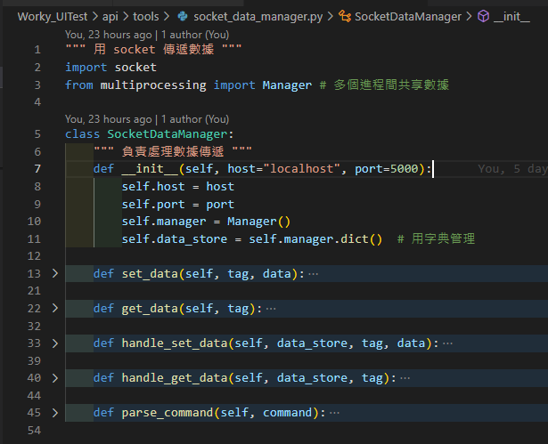

- **`set_data` 函數**：由 Client 端調用，發送 `SET_DATA` 指令至伺服器，附帶標籤 (`tag`) 和數據內容 (`data`)。
- **`handle_set_data` 函數**：由 Server 內部調用，負責處理伺服器收到的 `SET_DATA` 指令，將數據存入標籤對應的存儲空間。

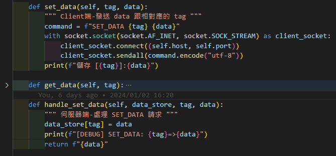

範例:
Client 端將訪問憑證存儲為 `new_access_token`，並通過標籤 `labor_token` 進行分類管理，供後續查詢使用。

在 `server_task` 內

- 利用 `parse_command` 拆解為操作類型 (`action`)、標籤 (`tag`)、和數據 (`data`)。
- 根據指令執行相應的數據操作（如 `SET_DATA` 或 `GET_DATA`），並將結果回傳至客戶端。

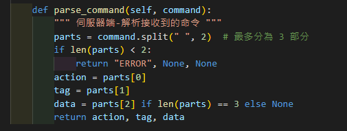

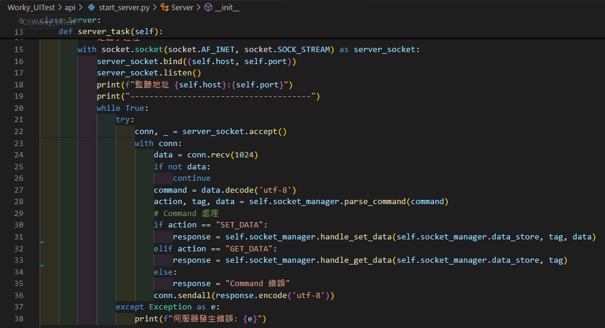

### 2. **start_server**

<aside>
💡

1. Server 啟動相關邏輯 
</aside>

`server_task` 函數主要負責伺服器的核心邏輯，包括根據 `SocketDataManager` 指定的 IP 和埠號來啟動伺服器，並處理客戶端的連線和數據傳遞。
此伺服器採用 TCP 通訊協議 (`SOCK_STREAM`)，確保數據傳輸的可靠性。

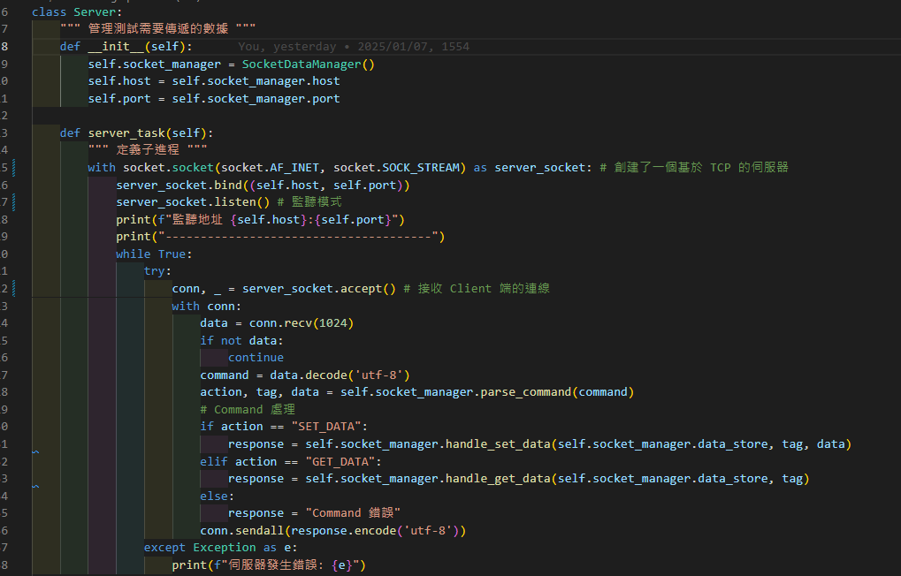

`start` 函數在子執行緒中啟動 `server_task`，避免阻塞主程式，允許主程式執行其他任務（如等待用戶輸入或執行測試腳本）。

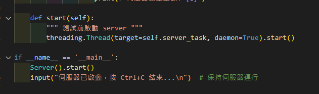
