# Log & Report

> 介紹如何分析和管理測試結果，包括查看 Appium 日誌和生成日誌以進行問題排查

測試生成的內容將存放於根目錄下的 `reports` 子資料夾，包含以下分類：

- **logs** 資料夾：存放測試日誌。
- **screenshots** 資料夾：存放測試截圖。
- **Test_Report.xlsx**：測試結果報表。


## logs (Appium Server log)

---

我將 get.log 設置在主測試流程內 (使用 \utils\logger_config 模組)

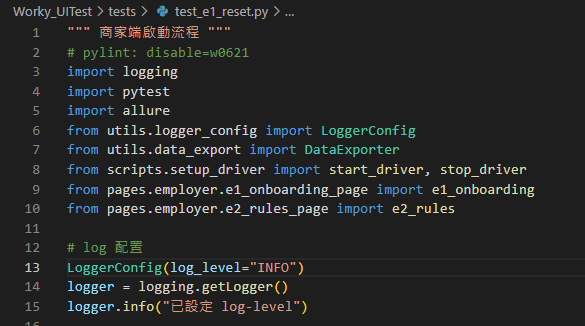

logger_config 模組內定義類別 LoggerConfig 用來設置儲存 log 位置跟檢查輸入的 log-level

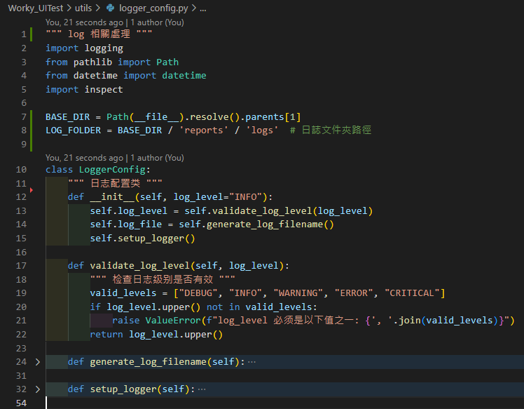

會在測試完主流程時產出 log 報告

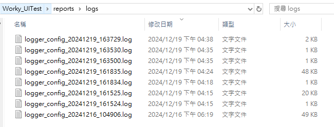

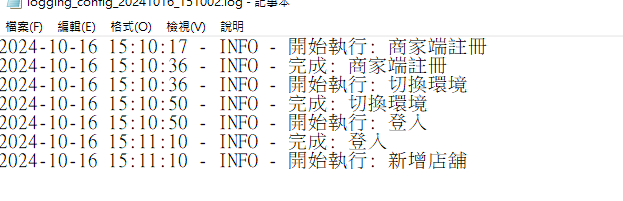

排查時可以把 log-level 設為 “DEBUG” 來查看更多資訊

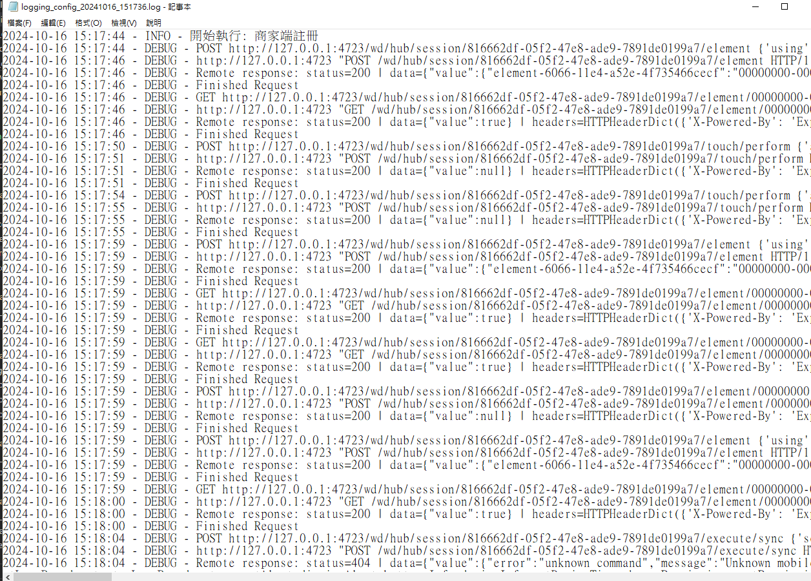

Appium 使用 UiAutomator2 來實現對 Android 應用的自動化測試
    
調適腳本時也可以查看 Appium Server 生成的 log

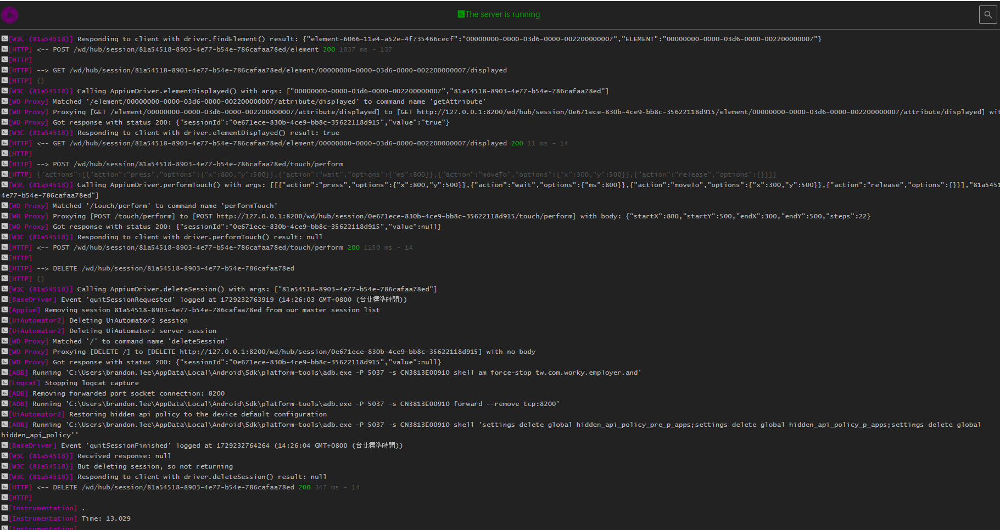

根據 W3C 協議啟動 Appium Client 向 WebDriver 發出查找元素的請求

```
[W3C (81a54518)] Responding to client with driver.findElement() result:
```

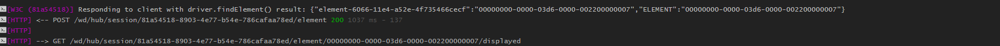

如果 element display 則回傳 status 200

```
GET /wd/hub/session/81a54518-8903-4e77-b54e-786cafaa78ed/element/00000000-0000-03d6-0000-002200000007/displayed 200
```

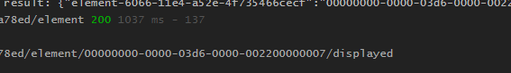

呼叫 appium 內建模組 performTouch tap 螢幕

從座標(800,500)滑到(300,500)

```
[W3C (81a54518)] Calling AppiumDriver.performTouch() with args: [[{"action":"press","options":{"x":800,"y":500}},{"action":"wait","options":{"ms":800}},{"action":"moveTo","options":{"x":300,"y":500}},{"action":"release","options":{}}],"81a54518-8903-4e77-b54e-786cafaa78ed"]
```

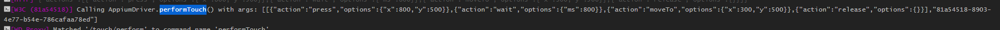

測試結束時 Deleting Session

```
[UiAutomator2] Deleting UiAutomator2 session
```

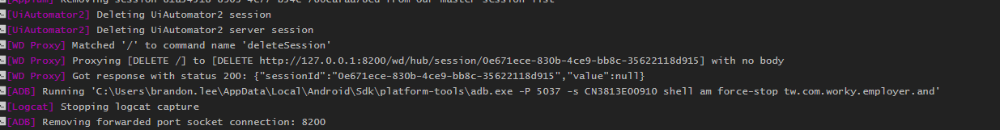
    


## screenshots

---

我將頁面截圖寫死在頁面測試流程內 (使用 \utils\image_action 模組)

例如: `e7_tutorial_page.py` 頁面對新手教學的各頁面進行截圖

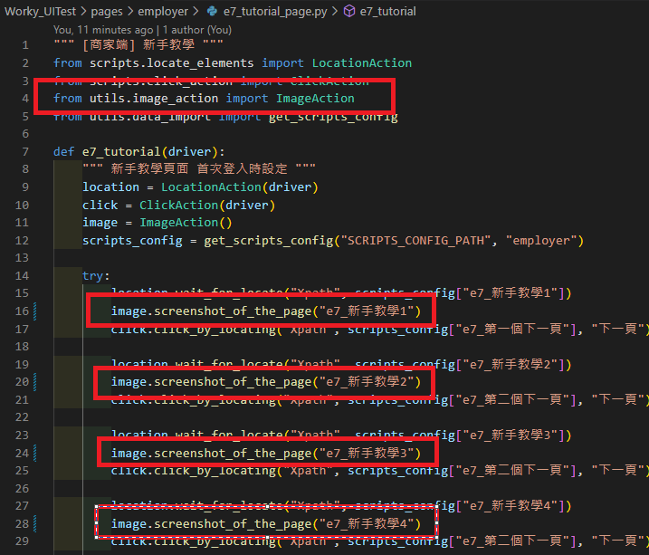

目前是使用固定命名，讓同個頁面較新的圖取代舊的

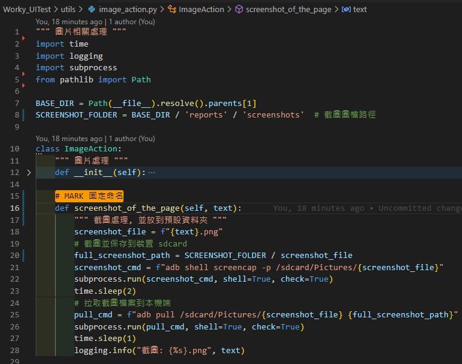

可直接在 **screenshots** 資料夾下察看結果，captcha 資料夾是專門處理驗證碼或打卡碼的圖像辨識

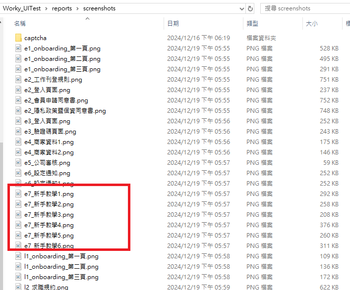


## Test_Report

---

root\utils\excel_operations.py：管理 ”測試報告” 導入的規範 (Test_Report.xlsx) 

root\utils\data_export.py：管理 “測試報告” 導出 (Test_Report.xlsx) 

root\utils\data_import.py：管理 “數據驅動” 導入 (Test_Config.xlsx / Scripts_Config.xlsx)

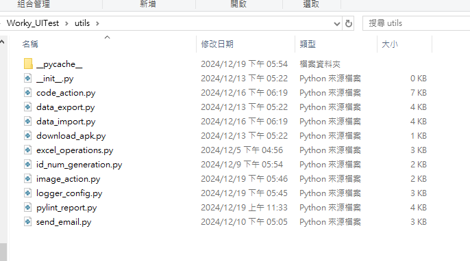

測試結果會自動添加在最下方並生成流水號 (以頁面測試當做一列測項)

<aside>
⚠️

測試過程不能操作 (開啟) XLSX 檔，系統判斷編輯中可能導致匯入或匯出數據失敗

</aside>

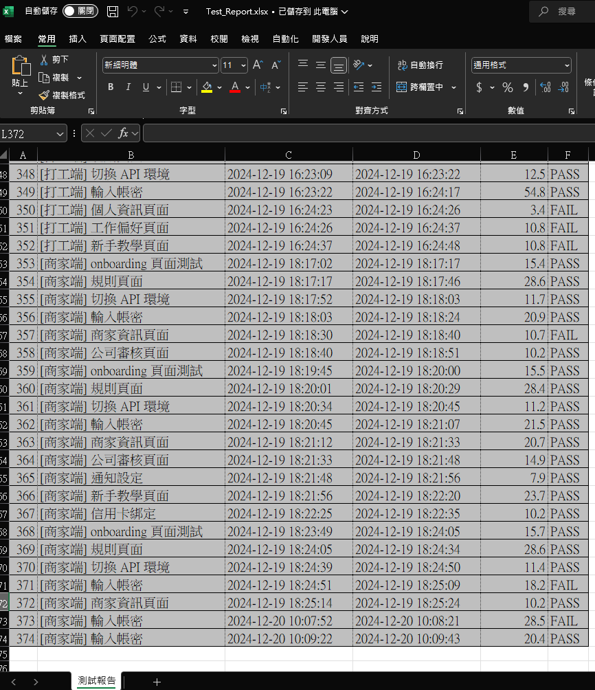


## 定義 Error_code

---

目前架構針對動作模組添加 error code 方便排錯，可參考 \reports\docs\Error_code.txt

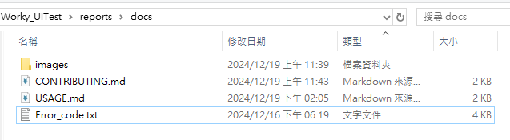

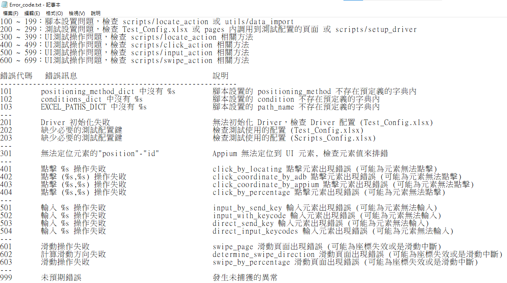

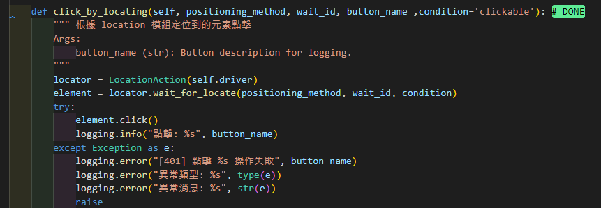


## Allure

---

在根目錄下方直接輸入

```bash
pytest --alluredir=allure-results
```

即可產生 allure 報告，pytest 會自動抓取目錄下方名稱開頭 test 的腳本，並依照順序執行

這部分與 UI 測試邏輯相同，在命名主測試腳本時要依照想要執行順序用流水號命名

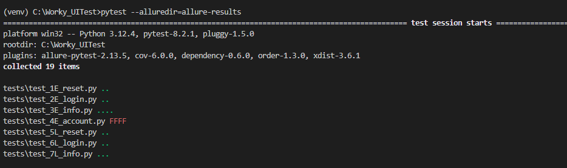

輸入 

```bash
allure serve allure-results
```

直接用網頁查看可視化報告

可透過查看 allure 內記錄下的 log 或是上方排錯的方法來調適腳本

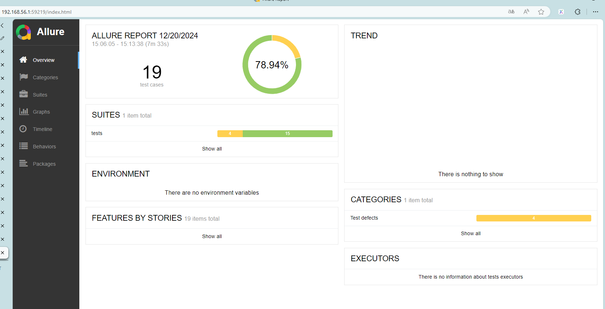

執行 test_e7_1 時發生錯誤

log 說明在做截圖時出現 CalledProcess 類型的 Error

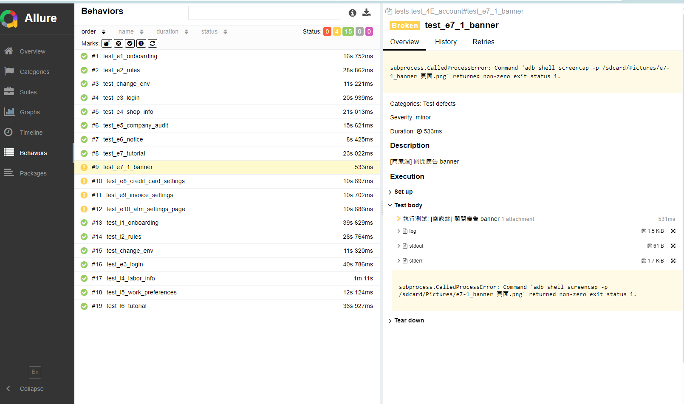

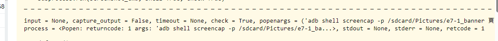

開啟錯誤的頁面腳本檢查，發現編碼時用到 ’ - ‘ 改為 ‘ _ ’

修正完後可只對錯誤的主測試腳本執行 

```bash
pytest tests/test_4E_account.py --alluredir=allure-results
```

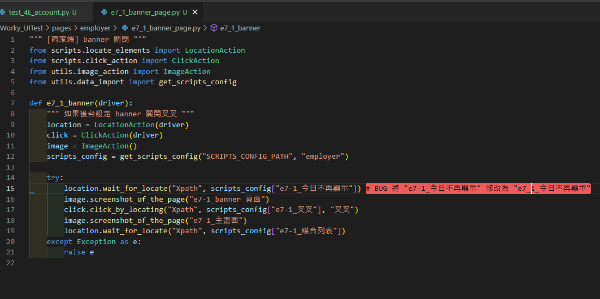

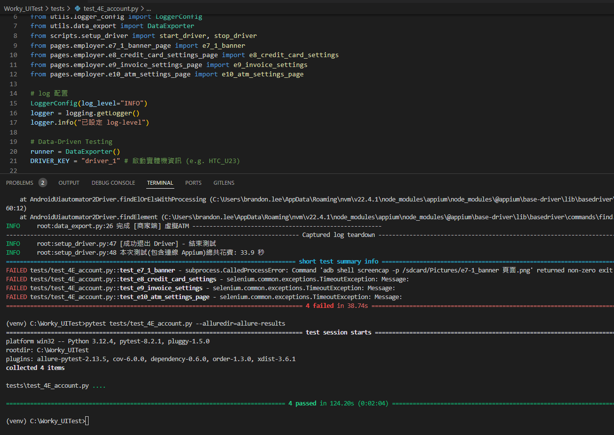

再次檢查報告就會發現問題得到修正

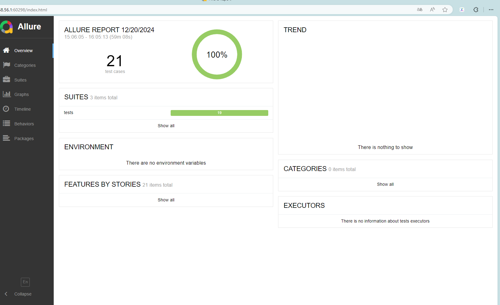