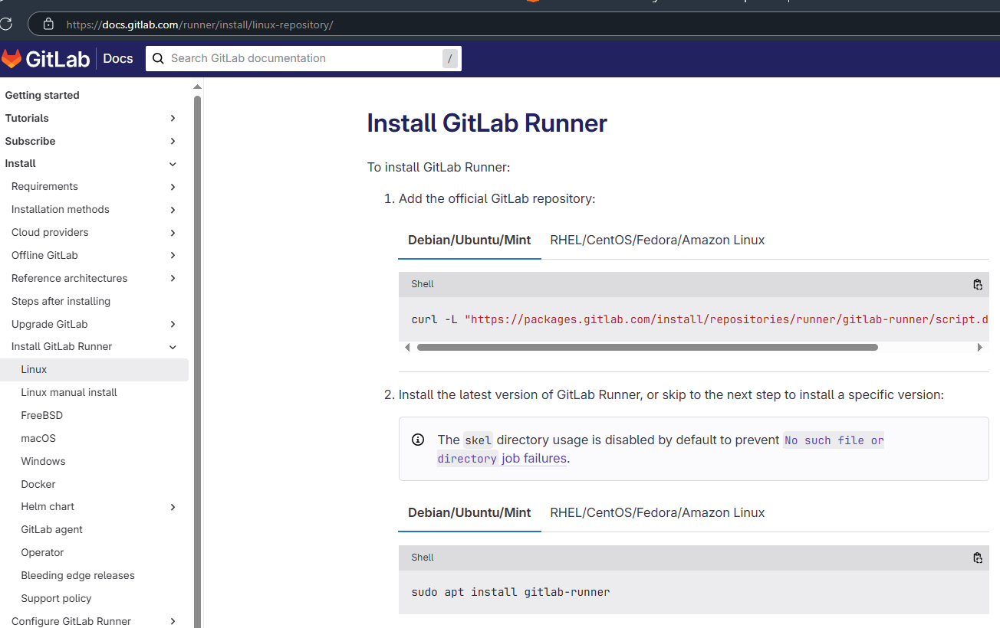
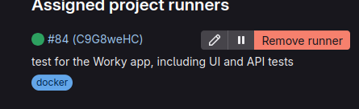
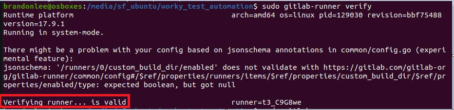
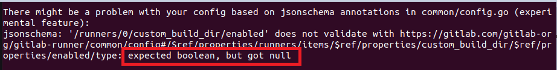

# GitLab Runner

> 介紹如何自建 gitlab runner


---

## Download GitLab Runner

---



### Q1 :

有可能碰到 gitlab > CICD setting > Runner 標示 warning (圖為成功後)




可檢查驗證

`sudo gitlab-runner verify`



### Q2 :

 JSON Schema 錯誤：`expected boolean, but got null`



1. 打開 GitLab Runner 配置文件 `sudo nano /etc/gitlab-runner/config.toml`
2. 修改 `custom_build_dir.enabled` 設定 enabled = false


按 `Ctrl + X`，然後按 `Y` 來儲存。

1. 重啟 GitLab Runner  `sudo gitlab-runner restart`

### Q3 :

碰到 job 卡住可以手動觸發 runner  

```bash
sudo gitlab-runner run
```

`gitlab-runner/config.toml`  可順便設定 privileged ，最後會直接在虛擬機內開啟 docker 避免在 gitlab.yml 設置 D in D 增加複雜度


如果需要在 ci.yml 內啟動 docker 其中一種做法是在 config.toml 内掛載 docker.socket


