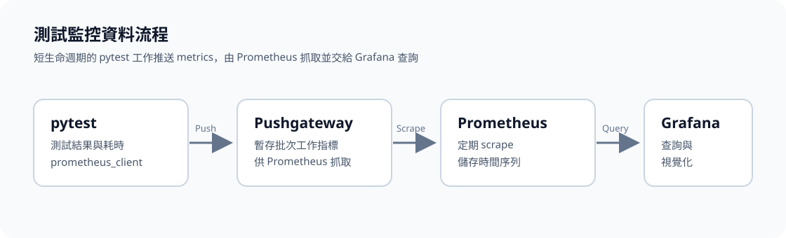
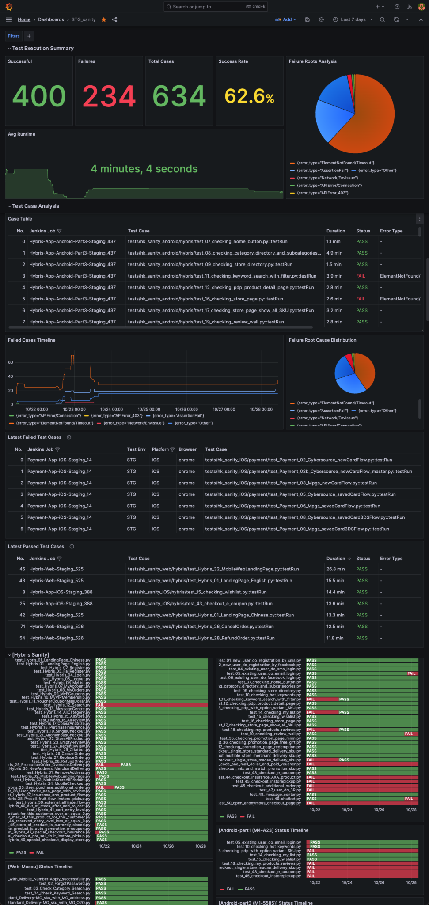

# 使用 Prometheus 與 Grafana 監控自動化測試

> 本文以電商自動化測試為例，整理如何將 pytest 測試結果推送到 Prometheus 監控鏈路，並說明 Prometheus、Pushgateway 與 Grafana 各自負責的部分。範例聚焦測試結果與執行時間；部署網址、Job 名稱及 CI 設定請依環境調整。本文圖表不包含內部網址、Job 名稱或測項名稱。

## 架構與資料流程

pytest 執行完測試後，專案以 Python `prometheus_client` 將指標送到 Pushgateway。Prometheus 定期從 Pushgateway 抓取指標；Grafana 再以 Prometheus 作為資料來源，供人員查詢和呈現趨勢。

```text
pytest / pytest-xdist workers
        │ 推送測試指標
        ▼
Pushgateway ◀── Prometheus 定期 scrape（15 秒）
                         │
                         ▼
                 Grafana 查詢與視覺化
```



此專案使用 Pushgateway，是因為測試工作屬於執行完就結束的批次工作，不適合要求 Prometheus 在測試程序存活期間持續抓取。Pushgateway 暫存由測試程序推送的資料，讓 Prometheus 後續抓取。

## 元件職責

| 元件 | 在測試監控中的用途 |
| --- | --- |
| pytest 與 `prometheus_client` | 記錄測項結果、耗時和分類標籤，並在測試階段結束時推送。 |
| Pushgateway | 暫存短生命週期測試程序推送的 metrics，提供 Prometheus 抓取。 |
| Prometheus | 依設定週期抓取 Pushgateway，儲存時間序列資料。 |
| Grafana | 連接 Prometheus，建立查詢、圖表與儀表板。 |



最近七天的儀表板摘要為 23 個成功、29 個失敗，共 52 個測項，成功率 39.1%，平均執行時間 5 分 41 秒。圖中的每日趨勢線只用來示範呈現方式。

## 專案中的測試指標

`metrics.py` 使用 `Gauge` 記錄兩類資料：

- `test_case_status`：測項結果，`1` 代表通過或略過，`0` 代表失敗。
- `test_case_duration_seconds`：測項執行時間，單位為秒。

兩種指標都帶有 `test_name`、`env`、`browser`、`platform` 和 `error_type` 標籤，方便依測項、環境、瀏覽器、平台或錯誤類型篩選。推送時另外使用 `instance`、`build_number`、`worker` 和 `push_time` 作為 grouping key 的識別欄位。

pytest-xdist 會啟動多個 worker。專案把 worker ID 放進 grouping key，避免同一個 Jenkins build 中不同 worker 推送的資料互相覆蓋。推送操作也設定 timeout 與重試，並在推送後清理超過 30 天的舊資料。

## 設定位置

- `metrics.py`：建立測試 metrics、推送至 Pushgateway、重試與清理舊資料。
- `infra_config.py`：集中提供 Pushgateway 連線設定；Jenkins 可透過環境變數覆蓋相關設定。
- `monitoring/prometheus.yml`：設定 Prometheus 每 15 秒抓取一次 `pushgateway:9091`，並保留 Pushgateway 傳來的標籤。
- `monitoring/docker-compose.yml`：啟動 Pushgateway、Prometheus 和 Grafana 服務。

Docker Compose 中的服務名稱讓同一個 Docker network 裡的 Prometheus 能以 `pushgateway:9091` 連到 Pushgateway。主機端則可透過 Compose 的 port mapping 存取各服務；不同環境的 port 可能不同。

## 驗證資料流程

1. 啟動 monitoring 的 Docker Compose 服務。
2. 執行一批會產生測試指標的 pytest 測試。
3. 查看測試輸出，確認有推送成功的訊息，並留意 Pushgateway 連線失敗或重試訊息。
4. 在 Pushgateway 頁面確認收到對應 job 的 metrics。
5. 在 Prometheus Targets 頁面確認 Pushgateway target 為健康狀態，並查詢 `test_case_status` 或 `test_case_duration_seconds`。
6. 在 Grafana 設定 Prometheus data source，建立查詢與面板。

在 Prometheus 的 **Status → Targets** 頁面確認 Pushgateway target 為 `UP`，再於 **Graph** 頁面查詢 `test_case_status` 或 `test_case_duration_seconds`。若 target 為 `DOWN`，先確認 Prometheus 與 Pushgateway 位於相同 Docker network，且 scrape URL 使用 Compose 服務名稱與容器 port（例如 `pushgateway:9091`）。

## 維運時要注意的事

- Pushgateway 是暫存與轉交點，不負責長期時間序列查詢；查詢和保留資料由 Prometheus 負責。
- grouping key 會影響資料是否互相覆蓋。平行 worker、不同 build 或不同執行時間需要有適當識別欄位。
- 專案會清理 Pushgateway 中超過 30 天的舊分組；Prometheus 自己的資料保留時間則由 Prometheus 啟動參數設定，兩者是不同層的清理。
- Grafana 儀表板和告警規則應以實際部署設定為準；本文列出的是專案程式和 monitoring 設定中可確認的資料流程。
- 正式環境請將服務帳密和連線資訊放在環境變數或受控的 secret store，不要提交到版本庫。
