# Docker

---

> **Docker 使用 WSL 2 內核運行時**，若主機系統是 **Windows**，直接訪問 USB 設備會受到限制。這是因為 WSL 2 的 Linux 子系統與主機硬體層隔離，無法直接操作 USB 端口。此外，由於 WSL 2 虛擬網絡環境的設計，主機與 WSL 之間的網絡通訊採用 NAT 模式，無法輕易透過 TCP/UDP 暴露端口來直接與 USB 設備進行串接。
> 

因此選擇在 **Linux** 內核下驅動 Docker 執行測試，有兩種常見的做法

1. **Windows + Linux 雙系統啟動**
2. 虛擬機環境 (Linux 核心)


## Install Docker

---

> Docker 的核心邏輯是透過 **Dockerfile** 定義應用環境及依賴，生成輕量的容器映像，並利用**Docker Compose** 以簡潔的 YAML 配置文件來編排多容器應用的部署與協作，實現高效的環境管理與一致性。
> 

鑒於 Docker 無法完整控制 host 機上的 USB 埠，用虛擬機運行   Docker file 可以標準化測試環境，並且易於擴展

<aside>
💡

使用剛剛設置好的共用剪貼簿功能來安裝

</aside>

### 1. Update System Packages

開啟一個 terminal 窗口，並先更新系統套件，過程中要輸入使用者密碼

```bash
sudo apt update 
sudo apt upgrade -y
```

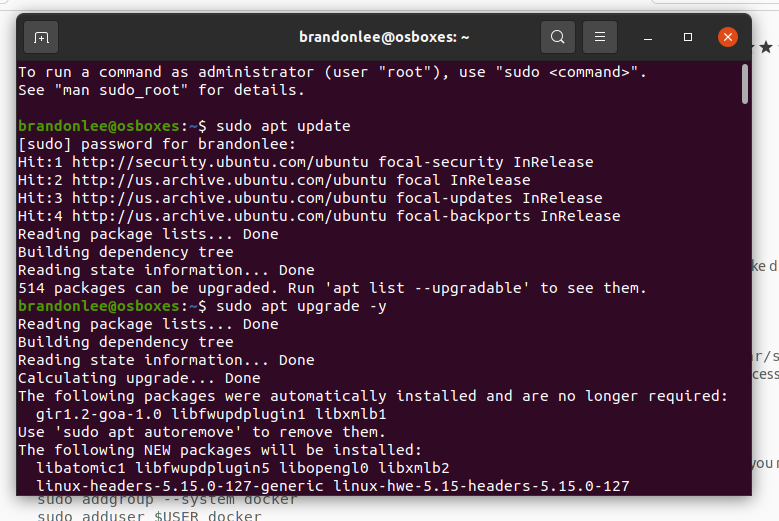

### 2. Install Required Packages

```bash
sudo apt install apt-transport-https ca-certificates curl software-properties-common -y
```

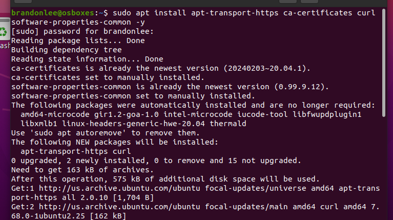

### 3. Add the Docker GPG Key and Repository

使用以下指令新增 Docker 官方的 GPG 金鑰和軟體倉庫：

```bash
curl -fsSL https://download.docker.com/linux/ubuntu/gpg | sudo apt-key add -
sudo add-apt-repository "deb [arch=amd64] https://download.docker.com/linux/ubuntu $(lsb_release -cs) stable"

```

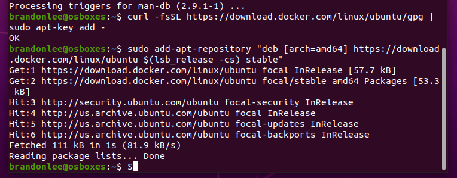

### 4. Install Docker Engine

更新套件列表並安裝 Docker CE（Community Edition）。

```bash
sudo apt update
sudo apt install docker-ce -y
```

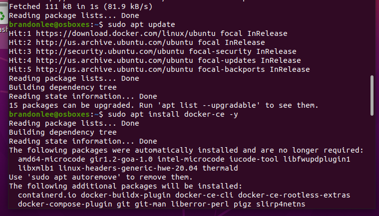

### 5. Start Docker and Enable the Service

```bash
sudo systemctl start docker
sudo systemctl enable docker
```

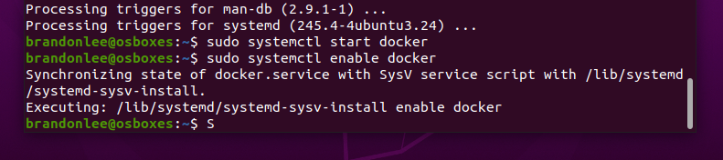

### 6. Verify the Docker Installation

```bash
docker --version
sudo docker run hello-world
```

第一句的 Unable to find image 是只在地端跟 Dockerhub 中還找不到一個名為 “hello-word” 的映像檔，latest 為 Docker 給每個映像檔預設的標籤，這邊顯示已成功安裝 Docker 

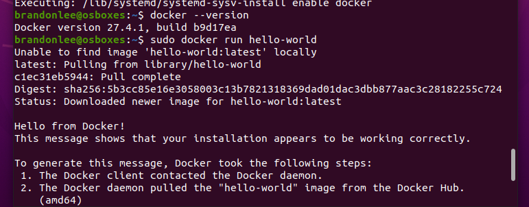

### 7. Grant Docker Access to a Non-Root User

預設情況下 Docker 需要 `sudo` 權限，可以將使用者加入 `docker` 群組

```bash
sudo usermod -aG docker $USER
```

重新登入或重啟系統，使設定生效

可輸入 `groups`查看

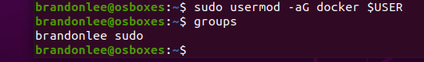

### 8. Install Docker Compose

Docker Compose 是用來定義和管理多個容器應用的工具。

```bash
sudo curl -L "[https://github.com/docker/compose/releases/download/v2.25.0/docker-compose-$](https://github.com/docker/compose/releases/download/v2.25.0/docker-compose-$)(uname -s)-$(uname -m)" -o /usr/local/bin/docker-compose
sudo chmod +x /usr/local/bin/docker-compose
```

驗證 Docker Compose 是否安裝成功 (可檢查封包的文件大小是否大約 10 M)

```bash
docker-compose --version

```

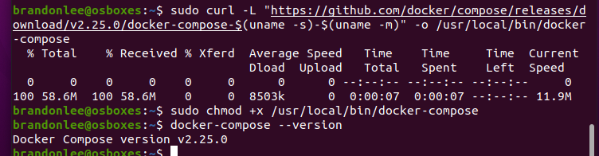


## Docker Compose

---

> 我在做 docker 封包時有做一個簡易的容器運行架構，可以參考 [/SQATP/vm.git](http://122.147.190.35/SQATP/vm.git)
> 

主要是透過

1. Dockerfile：生成靜態 image，負責安裝必要工具與構建運行環境
2. docker-compose.yml：用於定義和啟動容器的服務配置
3. start.sh：啟動 Appium 測試的腳本，通過 docker-compose.yml 引入

<aside>
⚠️

同一個連接埠僅可被分配給單一主機使用，這邊需要先分配給虛擬機才能用 start.sh 運行

</aside>

(裝置跳出允許連線彈窗要將永久允許選項打勾)

通常共享的資料夾會在 media 下

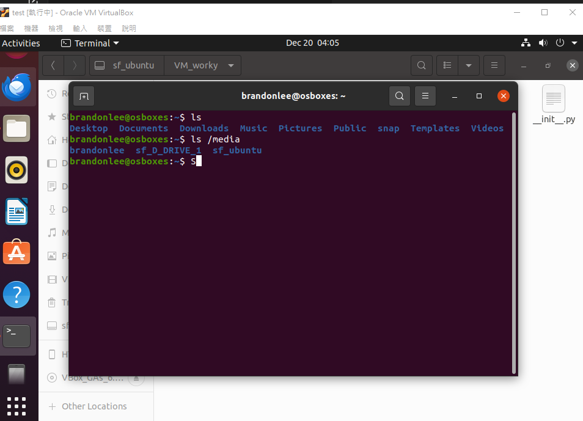

先移到根目錄下，輸入 (我的共享資料夾叫 ubuntu ，專案根目錄叫 VM_worky)

```bash
cd /media/sf_ubuntu/VM_worky
```

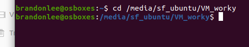

使用無緩存模式重新構建 Docker 映像，命名為 `worky-test-image`，輸入

```bash
docker build --no-cache -t worky-test-image:latest .
```

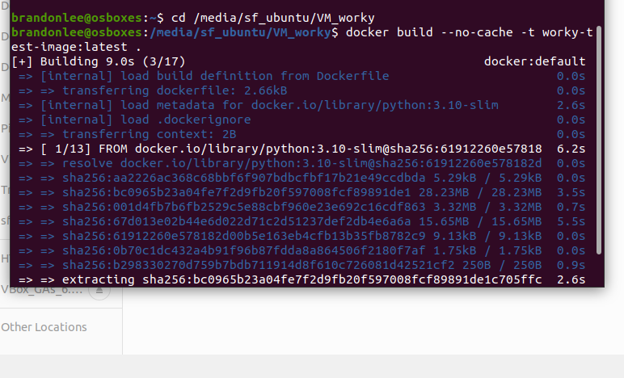

執行完畢後可輸入 `docker images` 檢查映像是否建立成功。由於構建需要安裝完整的測試環境，建議先驗證映像是否正常運行，腳本的選單則可直接執行檢測。

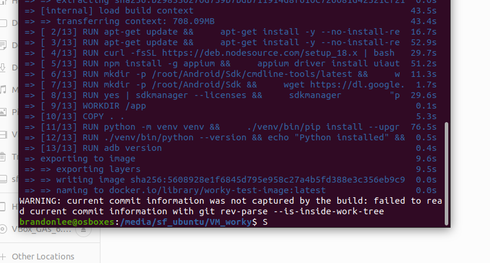

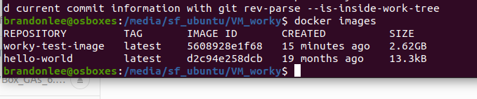

我設計在容器內啟動 `adb server` 和 `appium server`，以實現與主機的完全隔離，避免主機端和容器端的端口衝突。因此，當使用 `docker-compose` 運行容器時，需確保主機上沒有其他程序（例如 ADB 或 Appium）占用相關的服務端口（如 5037 或 4723）。

<aside>
⚠️

若在容器內運行 ADB 時遇到 USB 權限問題，可以執行以下命令修正權限：

```bash
sudo chmod -R 777 /dev/bus/usb
```

</aside>

目前在 `docker-compose.yml` 中已指定映像名稱，因此在構建映像時，請確保名稱與標籤（tag）正確。例如 ”`worky-test-image:latest`"。

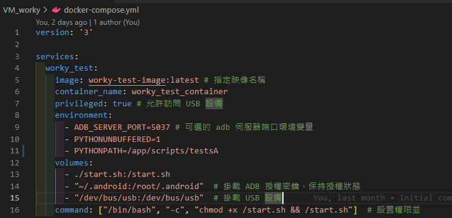

完成映像構建後，可以使用以下指令執行：

```bash
docker-compose up
```

這將根據 `docker-compose.yml` 的設定啟動容器，並根據 `start.sh` 文件的內容進行初始化流程，包括：

1. 啟動 `adb` 服務
2. 連接設備並檢查狀態
3. 啟動 `Appium`
4. 運行測試腳本
5. 測試完成後關閉 `Appium`

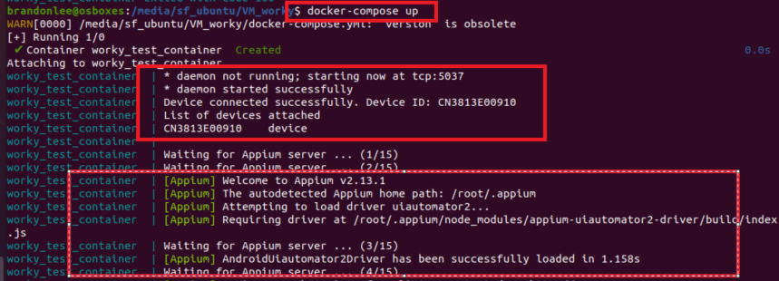

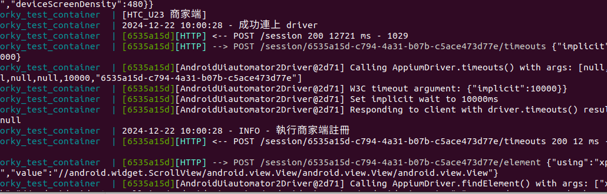

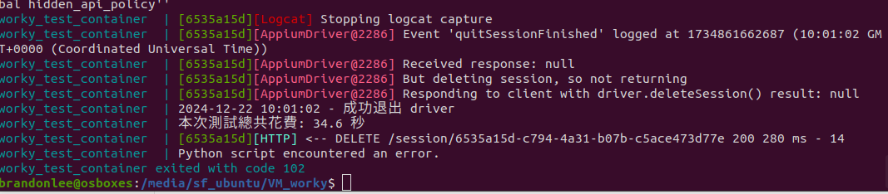
