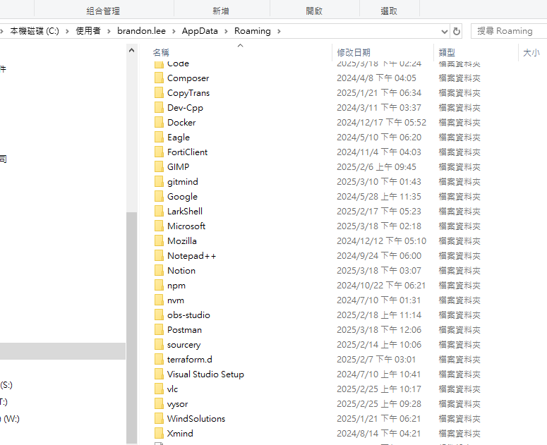
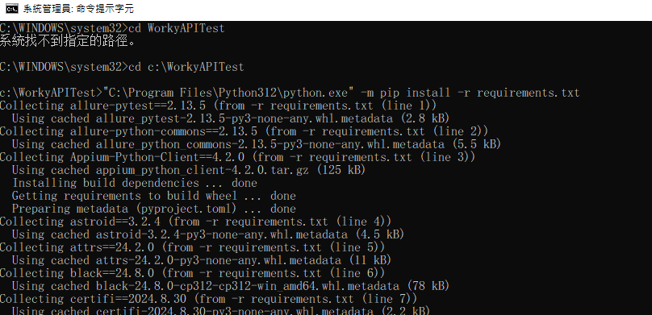
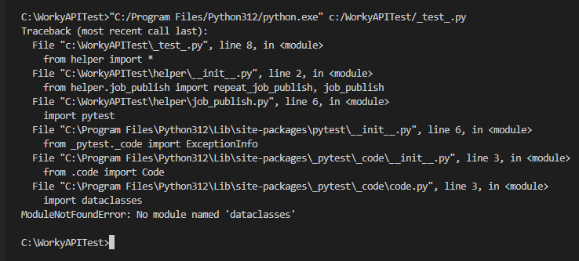
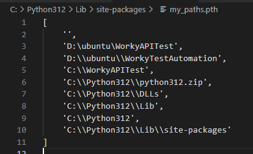

# Python Environment

---

pip 下載 python requirement 相關插建時可能會碰到無法下載進 C:/Program Files 的問題

會變成在 user 內部建立一個 Python 資料夾來放 site-packages

可以手動刪掉路徑並用系統管理員開啟 cmd 來使用 `pip install requirement`

pip 預設使用快取加快構建速度

可以清除快取來重新構建

`pip cache purge
 pip install --no-cache-dir -r requirements.txt`

可自己在 site-package 內新增 `.pth` 文檔

