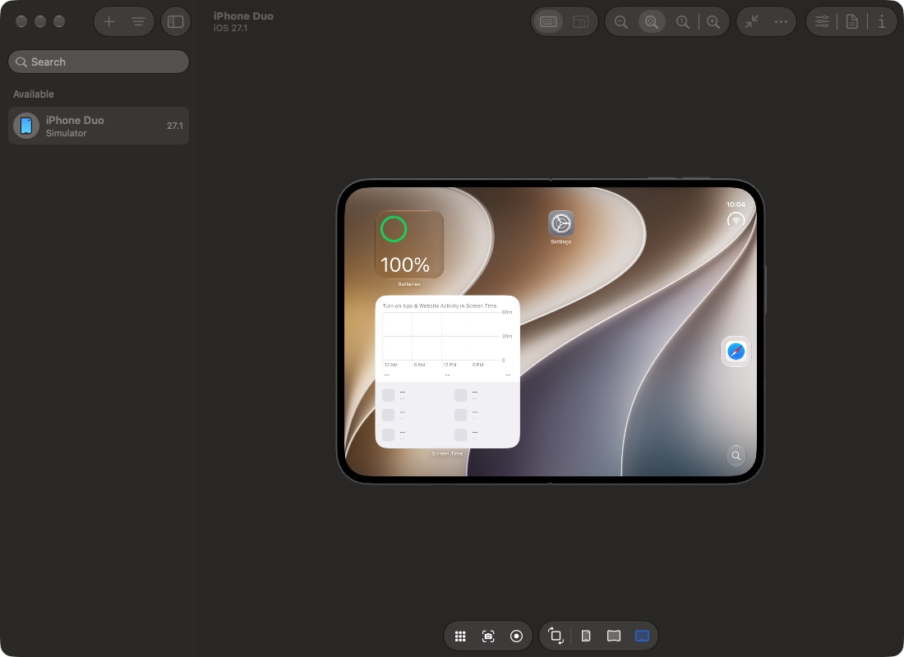
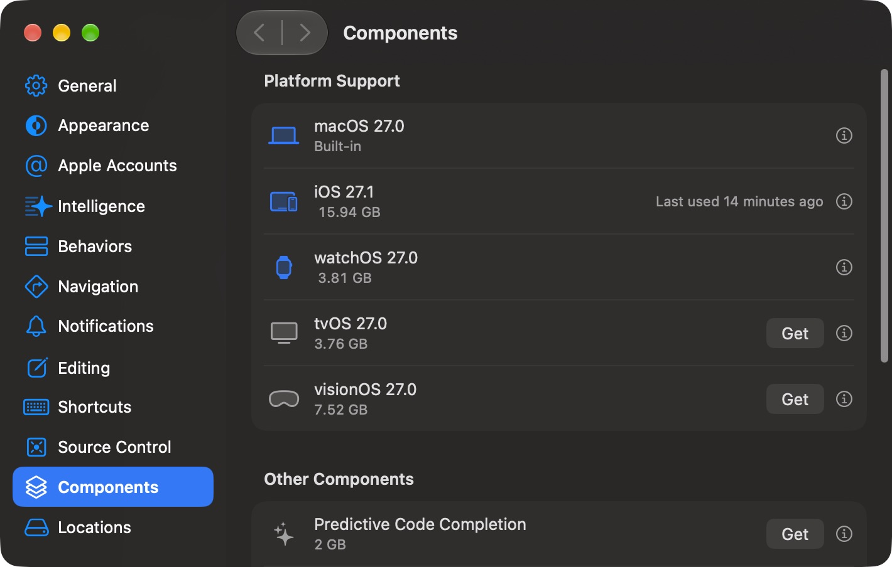

# Xcode 27.1 設定 iPhone Simulator 與 Device Hub

Xcode 27 開始，iPhone Simulator 的操作整合到 **Device Hub**。本文以 Xcode 27.1、iOS 27.1 與 iPhone Duo 為例，說明如何建立模擬器、啟用 Mac 鍵盤、中英文輸入，以及讓 Mac 與 Simulator 共用剪貼簿。



上圖是本機 Xcode 27.1 Device Hub 的 iPhone Duo 畫面；圖片已放在此 repository 的 `docs/images/`，方便離線預覽與版本控管。

## 使用前確認

先確認以下條件：

- 已安裝 Xcode 27.1。
- Xcode → **Settings → Components** 已安裝對應的 iOS Simulator runtime。
- `xcode-select` 指向目前使用的 Xcode：

```bash
xcode-select -p
xcodebuild -version
```

輸出應類似：

```text
/Applications/Xcode.app/Contents/Developer
Xcode 27.1
Build version 27A9275
```

如果找不到可用的 Simulator runtime，Device Hub 可能會顯示空白，或無法建立新的 Simulator。



在這個畫面中，**iOS 27.1** 顯示的是 Xcode 的平台支援；實際能否建立 Simulator，仍要用 `xcrun simctl list runtimes` 確認可用的 Simulator runtime。

## 建立 iPhone Simulator

1. 開啟 **Device Hub**。
2. 點選左側欄上方的 `+`。
3. 選擇 **Simulators**。
4. 選擇要建立的 iPhone 型號與 iOS runtime。
5. 建立完成後，從左側清單選取該 Simulator。
6. 雙擊裝置，或從 Xcode 的 Run destination 啟動它。

> Xcode 27 的 Device Hub 同時管理實體裝置與 Simulator。Simulator 不一定會在第一次開啟 Device Hub 時自動出現在清單中，必須先建立裝置。

## 啟用 Mac 鍵盤輸入

在 Device Hub 顯示 iPhone 畫面後：

1. 點選工具列的 **Capture Keyboard**。
2. 確認按鈕狀態變成 **On**。
3. 點入 Simulator 裡的文字欄位。
4. 現在就可以直接使用 Mac 鍵盤輸入。

啟用後，Device Hub 會顯示 `Capturing Keyboard`。要停止擷取鍵盤，可以按 `Esc`，或再次點選 **Capture Keyboard**。

### 中英文輸入

Capture Keyboard 使用 Mac 的鍵盤輸入，因此中英文切換應在 macOS 端完成：

1. 先按 `Esc` 暫停鍵盤擷取。
2. 使用 macOS 的輸入法切換快捷鍵，例如 `Control + Space`，切換到「中文」或「ABC／英文」。
3. 回到 Device Hub，再開啟 **Capture Keyboard**。
4. 點入 iPhone Simulator 的文字欄位後輸入。

如果中文輸入法的組字過程不穩定，可以先在 Mac 上輸入完整中文內容並複製，再使用 Device Hub 的 **Get Clipboard** 貼入 Simulator。

## 啟用 Mac 與 Simulator 共用剪貼簿

在 iPhone Duo 的 Device Hub 視窗中，開啟：

```text
Edit → Use Shared Clipboard
```

Device Hub 的 `Edit` 選單主要會看到以下三個剪貼簿操作：

```text
Use Shared Clipboard
Get Clipboard
Send Clipboard
```

新增裝置時，工具列的 `+` 選單則會提供：

```text
Simulators
iPhone…
iPad…
Apple Watch…
Apple Vision Pro…
Apple TV…
Pair Nearby Device…
```

另外也可以使用下列兩個單次操作：

| 功能 | 用途 |
| --- | --- |
| Get Clipboard | 將 Mac 剪貼簿內容取得到 Simulator |
| Send Clipboard | 將 Simulator 目前的剪貼簿內容送回 Mac |

測試方式：

1. 在 Mac 上複製一段文字。
2. 在 Simulator 開啟 Safari 或備忘錄等文字輸入欄位。
3. 執行 `Edit → Get Clipboard`。
4. 在文字欄位中貼上，確認內容已傳入。

如果要長時間雙向同步，使用 **Use Shared Clipboard**；如果只想傳送一次，使用 **Get Clipboard** 或 **Send Clipboard**。

### 剪貼簿的資安注意事項

共用剪貼簿會讓 Mac 與 Simulator 之間互相傳送文字或其他剪貼簿內容。請注意：

- 不要在啟用共用剪貼簿時複製密碼、API key、access token、Cookie 或私鑰。
- 測試完成後，若不需要同步，請關閉 `Edit → Use Shared Clipboard`。
- 從 Simulator 使用 `Send Clipboard` 前，先確認剪貼簿內容沒有包含測試帳號以外的個人資料或憑證。
- Device Hub 的畫面截圖可能包含帳號、通知或測試資料；分享前應先檢查並遮蔽敏感資訊。

## 所有按鍵都變成 `a` 的處理方式

這通常不是 iPhone 鍵盤硬體問題，而是 Device Hub 的鍵盤擷取狀態或輸入法焦點卡住。依序嘗試：

1. 按 `Esc` 停止 **Capture Keyboard**。
2. 點選 Simulator 內的文字欄位。
3. 關閉再重新開啟 **Capture Keyboard**。
4. 在 macOS 切換一次英文輸入法，再切回中文或原本使用的輸入法。
5. 重新選取左側的 iPhone Duo，或關閉後重新開啟該 Simulator。

如果問題只在中文輸入法出現，先切換成 ABC／英文測試。英文正常但中文異常時，通常是輸入法組字與鍵盤擷取的焦點衝突；可改用剪貼簿傳送完整中文文字。

## Simulator 無法開啟或 Device Hub 沒有裝置

先確認 runtime 與 CoreSimulator 是否正常：

```bash
xcrun simctl list runtimes
xcrun simctl list devices
```

如果看到 `CoreSimulatorService connection refused`、找不到 runtime，或 Device Hub 顯示 `No Devices`：

1. 回到 Xcode → **Settings → Components**。
2. 安裝對應的 iOS Simulator runtime。
3. 關閉並重新開啟 Device Hub。
4. 回到 `+ → Simulators` 建立 iPhone Simulator。

不要只確認 Xcode 的 iOS SDK 已安裝；SDK 與可啟動 Simulator 的 runtime 是不同項目。

## 常用檢查指令

```bash
# 確認目前使用的 Xcode
xcode-select -p
xcodebuild -version

# 列出可用的 runtime
xcrun simctl list runtimes

# 列出已建立的 Simulator
xcrun simctl list devices
```

## 參考資料

- [Apple：Device Hub](https://developer.apple.com/documentation/xcode/device-hub)
- [Apple：Get the most out of Device Hub](https://developer.apple.com/videos/play/wwdc2026/260/)
- [Apple：Simulator Help Topics](https://developer.apple.com/library/archive/documentation/IDEs/Conceptual/simulator_help_topics/Chapter/Chapter.html)
